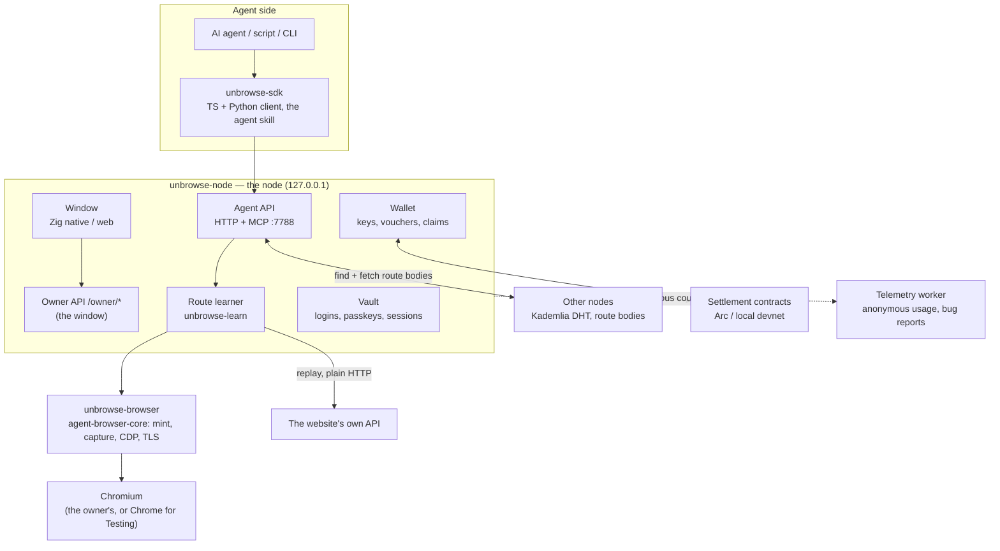
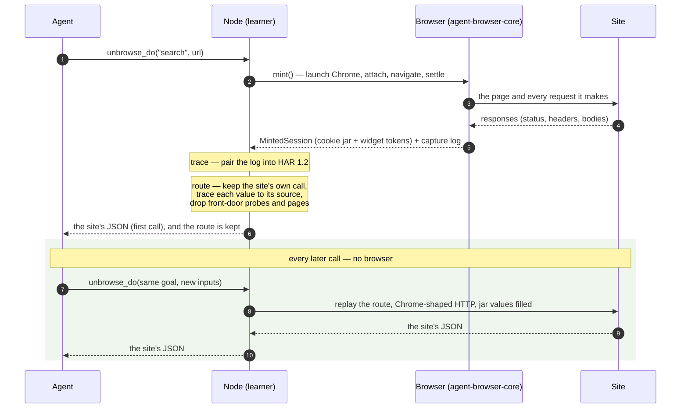
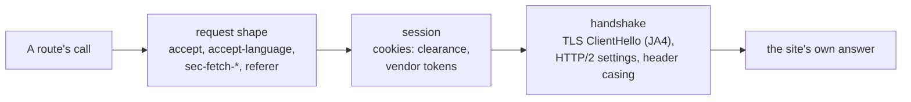
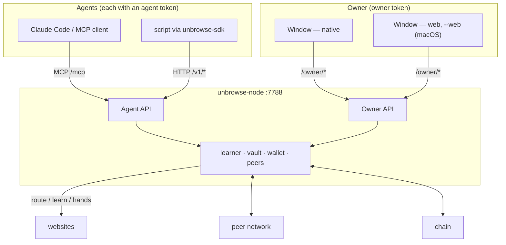
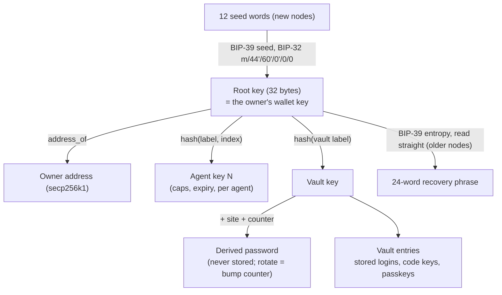
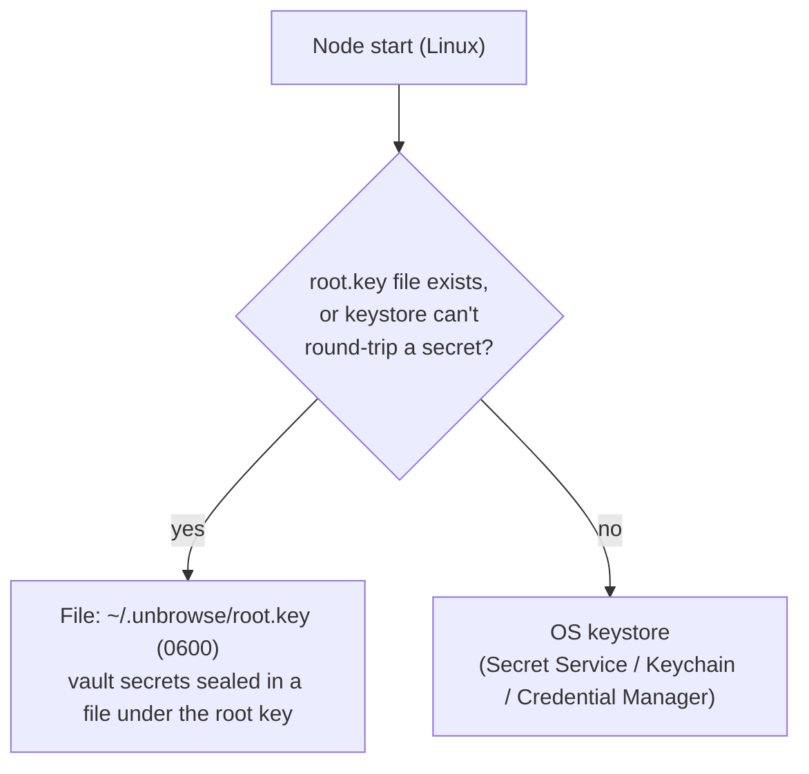
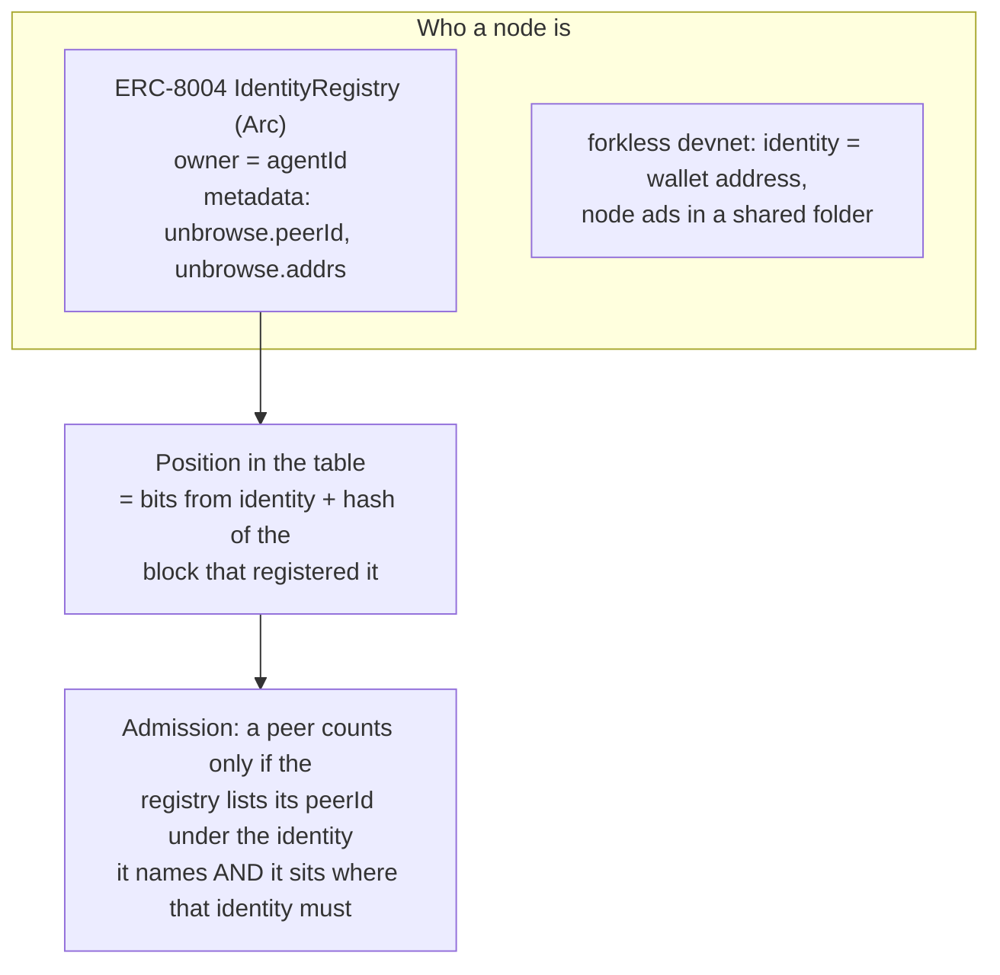
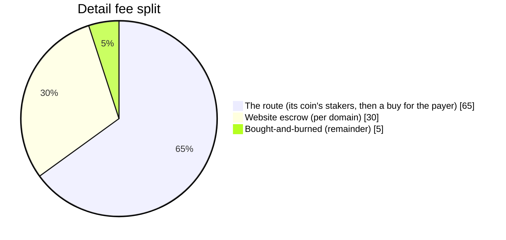
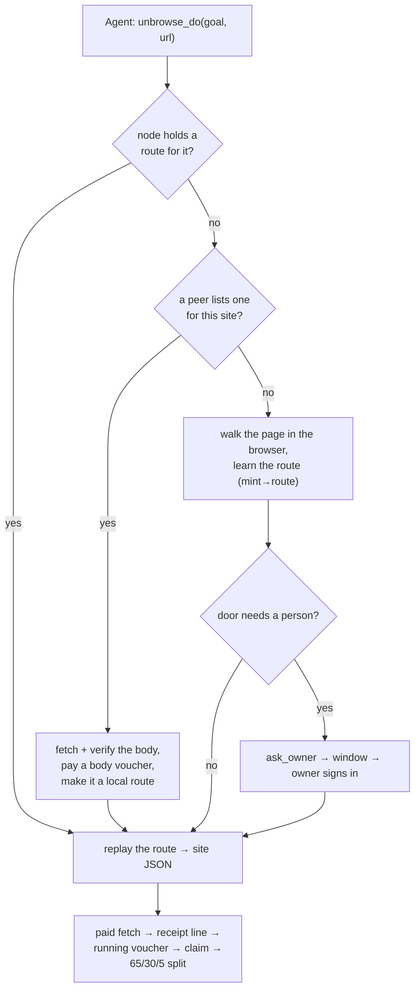

# Unbrowse architecture

How a website someone browses becomes a call an agent can make without a browser, and how those calls are found,
served and paid for across a network of nodes.

This is the map. The one-rule strategy and the hard-won pattern are in [AGENTS.md](../AGENTS.md); each directory's
own `README.md` is the detail, and [docs/README.md](README.md) lists every doc and the order to read them in.
Diagrams render on GitHub (Mermaid).

- [1. The idea in one paragraph](#1-the-idea-in-one-paragraph)
- [2. The pieces](#2-the-pieces)
- [3. The pipeline: browse once, call forever](#3-the-pipeline-browse-once-call-forever)
- [4. The door](#4-the-door)
- [5. Runtime: agent, node, site, window](#5-runtime-agent-node-site-window)
- [6. Keys and the vault](#6-keys-and-the-vault)
- [7. The peer network](#7-the-peer-network)
- [8. On chain: the money](#8-on-chain-the-money)
- [9. End to end](#9-end-to-end)

---

## 1. The idea in one paragraph

A **route** is one of a website's own API calls, learned once from a page the node's browser walked, and replayed
after that as plain HTTP — the way the site's own app talks to it. An agent says what it wants; the node calls the
route that does it, learns one from a page when it has none, or opens the page for the owner when only a person can
get past. Nodes find each other's routes through a distributed table keyed by site, serve each other the learned
calls for a fee, and settle those fees on chain.

---

## 2. The pieces

One engine, several consumers. The node links the engine directly — it never drives a browser daemon over a socket
(that boundary was a whole family of bugs; see [AGENTS.md](../AGENTS.md)).



| Directory | What it is | Language |
|---|---|---|
| [`unbrowse-node/`](../unbrowse-node) | The node: agent API (HTTP + MCP), route learner, vault, wallet, window | Rust, Zig, TS |
| [`unbrowse-browser/`](../unbrowse-browser) | `agent-browser-core`, a fork that records every request and typed value | Rust |
| [`unbrowse-sdk/`](../unbrowse-sdk) | `unbrowse` for npm + PyPI: the node, its browser, the skill, the client | TS, Python |
| [`unbrowse-node/app/contracts/`](../unbrowse-node/app/contracts) | Compiled ABIs for the Arc settlement, route-staking, domain, and bounty contracts | JSON ABI |
| [`unbrowse-node/crates/net`](../unbrowse-node/crates/net) | The peer network: Kademlia keyed by site, route bodies by content id | Rust |
| [`unbrowse-node/crates/files`](../unbrowse-node/crates/files) | The format and version of every file the node writes | Rust |
| [`unbrowse-telemetry/`](../unbrowse-telemetry) | The worker that takes nodes' anonymous usage events, and files their scrubbed bug reports as public GitHub issues | JavaScript |
| [`skills/`](../skills) | Agent skills that teach an agent to use the node | Markdown |
| [`antithesis/`](../antithesis) | The Antithesis harness: nodes, a chain and a site in containers, with a workload and the properties it checks | Docker, Python, shell |

The site's worker, which serves the owner's sign-in at `/link` and its relay, is a separate repository
(`unbrowse-landing`); the node reaches it at `UNBROWSE_SITE`.

---

## 3. The pipeline: browse once, call forever

`mint → walk → trace → route → call`. The first four happen once, in the browser; `call` is every time after, with no
browser.



- **mint** — `agent_browser_core::session::mint()` launches Chrome in process, returns a `MintedSession`. A per-site
  profile makes later mints cheaper.
- **walk** — the same call records every exchange into a capture log (subscribe before navigating: the first exchange
  is the page itself).
- **trace** — `walk_har()` pairs the log into HAR 1.2, read as a `Trace`.
- **route** — `build()` keeps the site's own calls and drops the pages and front-door probes.
- **call** — `RouteClient` replays over a Chrome-shaped transport, drawing session values from the jar. A value the jar
  lacks is omitted, as a browser omits what it does not hold; if the site needs it the call fails and the route is
  re-minted.

---

## 4. The door

A site decides "browser or bot" by reading three things. The route passes all three because it was learned from, and
measured against, a real browser. Gates are read from the walk's own traffic — never a named list of hosts.



| Layer | What the site reads | What passes it |
|---|---|---|
| request shape | `accept`, `accept-language`, `sec-fetch-*`, referer | send what a navigation sends, not what a script sends |
| session | cookies: clearance, vendor tokens | the mint's jar, harvested from the browser's own jar |
| handshake | TLS ClientHello (JA4), HTTP/2 settings, header casing | a browser-shaped transport, measured against the browser |

The node's TLS stack is BoringSSL patched to match Chrome's ClientHello, so the handshake a route sends is the one the
minting browser sent. **One identity end to end:** the browser mints under the same user agent the browserless client
later presents.

---

## 5. Runtime: agent, node, site, window

The node listens on `127.0.0.1:7788` and keeps everything under `~/.unbrowse`. Two faces: the **agent API**
(`/v1/*` + MCP `/mcp`, with an agent's token) and the **owner API** (`/owner/*`, with the owner's token — only the
window). The window is native on every platform (Zig on nanoui, GTK on Linux) and speaks to `/owner` directly
(`window/src/main.zig`). The owner token is minted fresh on every node start and the window re-reads it per
request. Every command, owner command, agent primitive and environment variable is in [CLI.md](CLI.md).

**At start** (`app/src/main.rs` `main`), in order: a command (`agent`, `vault`, `chain`, …) runs and exits; otherwise
the node runs a newer release unpacked under `~/.unbrowse/versions` instead, if there is one (`update::run_newest`);
picks its browser, downloading Chrome for Testing when there is none; opens the root key on its own thread, since on
macOS the first Keychain read can wait on a dialog; starts the chain, then joins the peer network once the chain, Settlement and the key are ready and the owner has acknowledged the current terms (`health::to_join`, `terms::standing`) and
runs the claim loop once a minute; and serves the agent and owner APIs, without waiting for the key or the chain.

**On disk**, under `~/.unbrowse`: `routes/<id>.json` (each route), `activity.jsonl` (the log), `settings.json`,
`agents.json` and `vault.json` (small indexes, no secret in them; `store.rs`), `jars/<host>.json` (each site's session)
with `jars/<host>.json.scope` (how far each of its cookies reaches — the `Domain` the site set it for, so a call
sends a clearance down the site as the browser that earned it would), `profiles/` (each site's browser profile),
`devnet/` (the local chain), `versions/` (unpacked releases), `owner.token` (readable only by the owner) and `nonces-taken` (the signed requests the node took in the last two minutes and the latest its clock has read, written
to disk before each request runs, so neither a restart nor a clock set back takes one of them again).



**When only a person can get past** (a login the vault has no entry for, a two-step code, a human check), an agent that
can see the page meets a check itself with `unbrowse_challenge`: the node shows the page as a picture, the agent's own
model reads it, and the node takes one click, drag or key at a time until the page stops asking. What a picture cannot
settle — a password, a one-time code — is the owner's, and the agent calls `unbrowse_browse ["ask_owner", "..."]`. The
page shows live in the window's **Browser** screen; the owner clicks and types on it; the agent carries on, signed in,
in the site's own profile. The agent never sees what the owner types, and the owner's manual sign-in is never turned
into a route.

---

## 6. Keys and the vault

Everything secret derives from one 32-byte **root key**. Agent keys, the vault key, and derived passwords are all
computed from it, so nothing per-agent or per-site has to be stored or backed up — any machine with the root key
re-derives them.



Where the root key and the vault's sealed secrets live depends on whether the OS keystore can be trusted:



The round-trip check writes a probe secret, reads it back and compares: some Linux keyrings *accept* a secret and
return other bytes, which would leave the node holding a key it can't read. When that happens the node keeps the key —
and the vault — in a file instead. macOS/Windows and healthy Linux keyrings keep using the OS keystore.

> **Recovery phrase.** A new node's root key is made from 12 seed words at the standard Ethereum path
> `m/44'/60'/0'/0/0` (`crates/core/src/seed.rs`), so the same 12 words open the same address in MetaMask, Rabby or any
> EVM wallet. The words are kept beside the key (`root.key.seed`, or a second Keychain item `root-key.seed`) so the node
> can show them again. A node made before seed words keeps its key, since its address is its identity on chain. Its 24
> words are the key's raw bytes written as BIP-39 *entropy*: they restore the key into an Unbrowse node, but a wallet
> app reading them derives a *different* address. To open such a node's wallet elsewhere, export its key
> (`wallet export`, an Ethereum keystore file). Restore tells the two apart by word count.

**Website passkeys** are on by default: when the **owner** signs in on a page by hand and the site offers a passkey,
the node keeps it (sealed under the root key) and answers the prompt itself. A vault login an agent fills arms
nothing — a passkey signs in as the owner with no password and no second factor, so one an agent could make would be
a credential stronger than its own key. See the root [README](../README.md) for the risk and how to turn it off.

---

## 7. The peer network

No node holds the whole map. A node keeps the routes it holds and uses, and finds the rest through a **Kademlia table
keyed by site** (`unbrowse-node/crates/net`, spec §52–§53).

### Identity and position



- **The key is the site.** Routes are announced and found under `/unbrowse/site/<registrable domain>`, so every page
  and subdomain of a site meets at one key. Ranking by meaning runs on the node, over one site's listings.
- **Positions are fixed, not chosen.** A node's position starts with bits drawn from its identity and the hash of the
  block that registered that identity — unknowable while grinding keys, and the identity can't move it. So no one can
  park a node next to one site's key.
- **One owner is one source.** Several nodes of one identity answering a lookup count once.
- **Checked before an agent sees it.** Each listing must be for the site asked about, and the chain must show it live
  and as that contributor's.

### Finding a site's routes, and fetching a body

A route's **body** (its recipe) is content-addressed. A node **never runs another node's route**: it fetches the body,
verifies the bytes against the content id in the signed listing, then makes it a route of *its own* that runs on its
own node under its own session.

```mermaid
sequenceDiagram
    autonumber
    participant C as Caller node
    participant DHT as Kademlia table
    participant P as Provider node (holder)
    participant Ch as Chain

    C->>DHT: GET_PROVIDERS(/unbrowse/site/example.com)
    DHT-->>C: provider peers (one per identity that counts)
    C->>P: /unbrowse/listings/1 — the site's listings
    P-->>C: signed listings (content ids, fees)
    C->>Ch: check each listing is live and this contributor's
    C->>DHT: find_body_providers(/unbrowse/body/<cid>)
    DHT-->>C: holders (contributor's own first, at most 20)
    C->>P: /unbrowse/body/1 + a body voucher
    P->>Ch: verify the voucher pays this entry's fee
    P-->>C: the body bytes
    Note over C: check bytes == content id (R7.19),<br/>make it a local route, run it
    Note over C: the use's receipt line names P as its server; no server is paid a share of the fee.<br/>Kept only once that line passes, then reused with no new payment while it works
```

Providers that fail or serve mismatched bytes are set aside for that body on a doubling schedule. libp2p carries it
(Kademlia, relay, DCUtR hole-punching over TCP/QUIC). Serving a body earns its node no share of the fee, and holding
another contributor's route writes nothing to the chain: `held.json` is the whole record (`peers::hold_tick`).

The whole network, its protocols, their bounds and timeouts, NAT, light mode and what a node does when the chain or a
peer stops answering: [NETWORK.md](NETWORK.md).

### Sharing by itself

The node lists the routes it learns without being asked (`autolist.rs`), within limits set by gas: in the default
`used` mode a route is listed once the node's agents have used it successfully on 3 days or 5 times, the most used
first, at most 2 a minute and 5 a day; `all` lists every route that has run once, 20 a day; `off` lists none. A route
is never listed if it was learned from the owner's own browsing, is another contributor's body, reaches an excluded
site, was kept off by the owner, or its body would carry anything of the session (`recipe::of_route`). What a body
holds, how a listing is signed and checked, and how a caller pays for, keeps and runs one: [SHARING.md](SHARING.md).

---

## 8. On chain: the money

Fees settle on **Arc** (an EVM network) or on a **local devnet** — Anvil, state in `~/.unbrowse/devnet`, that forks Arc
testnet so the ERC-8004 registries sit at their real addresses. On the devnet the node deploys a test USDC, a test UNB,
a stand-in UNB/USDC pool, the domain proofs, the four route-coin contracts and the **LeanSettlement** contract; on a live
network every node shares the contracts named in its network file (`unbrowse-node/app/networks/<name>.json`), which an
operator deploys once with `unbrowse-node chain deploy` ([OPERATIONS.md](OPERATIONS.md)). On Arc, Settlement is built on
Arc's own USDC. On Arc mainnet it is built on UNB's existing pool and token, which the repository's `arc-mainnet.json` doesn't
name: the operator names them on their own machine (`UNBROWSE_ARC_MAINNET_UNB`, and UNB's v4 pool by its key, `UNBROWSE_ARC_MAINNET_V4_*`, which the deploy puts the adapter `V4UnbPool` over), and a
mainnet deploy refuses to deploy its own (`chain::mainnet_guard`). Fees settle in **USDC**; route coins trade against
**UNB**, and nothing is bonded. On a live chain the node's key pays its own gas in Arc's native USDC; there is no sponsor (spec §76).
A devnet is only ever cheaper. What each write costs, where a fee goes and how a new owner
starts: [MONEY.md](MONEY.md). Neither Arc network file names a deployment yet.

### Writing to the chain

Every chain call the node makes goes through `app/src/rpc.rs`, which replaces alloy's `ProviderBuilder` under the same
name:

- **Timeouts.** Each request is bounded to 30 s and each connect to 10 s; a sent write is waited on for 60 s
  (`REQUEST_TIMEOUT`, `CONNECT_TIMEOUT`, `RECEIPT_TIMEOUT`). One RPC that never answers can no longer hold a claim pass,
  and every pass after it, for good.
- **Finality.** A write counts once its block is final, not when its receipt arrives (`rpc::finalized`, inside
  `mined!`): the chain's `finalized` block has reached it and it is still the block at its height. A write a reorg
  drops before then is an error, and its caller records nothing. Reads that decide a write already happened (a spent
  line, a hold) are made at the final block (`rpc::SETTLED`). Arc's blocks are final as they are committed, so on Arc
  this costs a read or two; the devnet's Anvil runs with `--slots-in-an-epoch 0` so its blocks are too.
- **The write lock.** The node's key sends one write at a time (`WRITING`), each with the nonce the chain gives it as it
  is sent, so the claim loop, an owner command and an address republish never take the same nonce.
- **Paying.** Before each write on a live network the node checks it can pay that write's own gas estimate at twice
  the gas price (`chain::short_of`). If it can't, the write isn't sent and the node says where to get gas.
- **Batches.** The calls of one write go as one transaction through Arc's Multicall3From, which keeps the key as each
  call's sender, where the batch runs as a call there (`rpc::batch`); elsewhere each call is its own transaction.

### Paying your own way

There is no sponsor and no account contract (spec §76). Every write is paid by the node's own key, a plain EOA, in
USDC on Arc. A node that only earns needs a few cents once for its identity; when its key can't pay its gas, the
sign-in page offers the owner one USDC transfer from their own wallet (`fund=<chain id>`, `link::page`). A deposit is
one call under USDC's EIP-3009 authorisation, with no approval (`chain::deposit`). The owner's side:
[ONBOARDING.md](ONBOARDING.md); the numbers: [MONEY.md §5](MONEY.md#5-paying-your-own-way).

### Decimals and claim timing

Each token counts in its own decimals: Settlement's USDC in what its deployment records (`Deployment.usdc_decimals`, read
from the token: 6 for Arc's USDC as an ERC-20, 18 for a devnet's test USDC unless `UNBROWSE_DEVNET_USDC_DECIMALS` says
otherwise), UNB and the native gas in 18. A fee rounds up; a cap, a deposit or a withdrawal rounds down
([MONEY.md §6](MONEY.md#6-decimals)).

Claims go once they pay for their gas: each minute the payer's node claims an agent's lines for an epoch once their gas
at the chain's price is at most a tenth of what they pay (`claim_gas_share`), once they fill a batch of 40, and whatever
they pay on the first pass after their epoch ends (`chain::claim_due`, `CLAIM_GAS`). A serving node claims the lines
naming it only once their window is half over and the payer hasn't (`chain::claim_owed`)
([MONEY.md §2](MONEY.md#2-every-action-that-needs-funds)).

### The flow

Payers deposit USDC. Their agents sign **running EIP-712 vouchers** off chain: no transaction per call. Each passed
receipt line is claimed straight from the payer's deposit, with its Merkle proof and the agent's signature; there are
no epochs to post and no council to wait for. The payer's node claims its agents' lines once a claim is worth its
gas, and always on the first pass after their epoch ends ([MONEY.md §2](MONEY.md#2-every-action-that-needs-funds)).

```mermaid
sequenceDiagram
    autonumber
    participant Owner as Payer (node's key)
    participant Agent as Agent key
    participant SC as LeanSettlement
    participant Coins as Coin contracts
    participant Pool as UNB/USDC pool

    Owner->>SC: deposit(USDC)
    Owner->>SC: authorizeAgent(key, cap per epoch, expiry)
    Note over Agent: each paid fetch adds a receipt line,<br/>the agent key signs a running voucher
    Owner->>SC: claimBatch(voucher, signature, lines, proofs)
    SC->>SC: draw each fee from the payer's deposit
    SC->>SC: split each fee 65 / 30 / 5
    SC->>Coins: the route's share, per entry and payer
    Coins->>Coins: pay the coin's staked, checked coins in USDC
    Coins->>Pool: swap the rest for UNB
    Coins->>Coins: buy the entry's coin on its curve and stake it for the payer
    Anyone->>SC: burnBatch(), once an epoch: buy UNB with the buffer and burn it
    Note over Coins: stakers claim their USDC at any time; nothing vests
```

### The split, per detail fee (spec §47.2)



| Share | Who | Notes |
|---|---|---|
| 65% | the route | sent to `CoinFetch`: the entry's staked, checked coins are paid their part in USDC, and the rest is swapped for UNB, buys the entry's coin on its curve and is staked for the payer. An entry with no coin yet has its share owed to its contributor in USDC |
| 30% | the website, per domain | escrow; released by `Domains.releaseEscrow` 14 epochs after the domain proves its wallet with DNSSEC (`claimEscrow`), then paid to it directly; a domain without DNSSEC can't be proven, and its share waits in escrow |
| 5% | bought-and-burned | the remainder, so the three always sum to the fee; waits in the burn buffer until `burnBatch`, once an epoch, buys UNB through the pool and burns it |

No server and no platform is paid a share.

**What the contract enforces:** a deposit moves only against a voucher the payer's agent signed, capped by the key's cap
per epoch and the payer's deposit; a voucher for epoch `e` is claimable in `e` and `e + 1`; a withdrawal waits two
epochs, so a payer can't leave ahead of vouchers it signed; each line is spent once. The split and every route-coin
number are fixed at deployment, with the tokens and the pool; nobody can change them. Every action that costs gas or tokens, what it costs measured, and how a node pays its own way are in [MONEY.md](MONEY.md). For the full route-staking and economy design, see [Payments, Staking & UNB](concepts/payments-and-unb.md).

---

## 9. End to end

One agent goal, pulling the pieces together:



### Under faults: the Antithesis harness

[`antithesis/`](../antithesis) runs nodes, a chain and a site in containers under Antithesis's fault injection, with a
workload that learns, lists, fetches and pays, and checks properties of the network and the money paths. Inside the
node, the `antithesis` Cargo feature (off by default) compiles in the SDK's assertions at the places the harness can't
see from outside (`app/src/antithesis.rs`, `crates/net/src/antithesis.rs`): for example that a network route that
writes never runs for a goal that only reads, and that a fetched body is kept only with a passed line. Without the
feature each assertion is nothing. `antithesis-coverage` adds the coverage runtime. How to build and run it:
[TESTING.md](TESTING.md); the property catalog is in `antithesis/scratchbook/`.

Read next: [AGENTS.md](../AGENTS.md) for the pattern and the operating rules, then the directory you are changing —
each has its own `README.md`.
