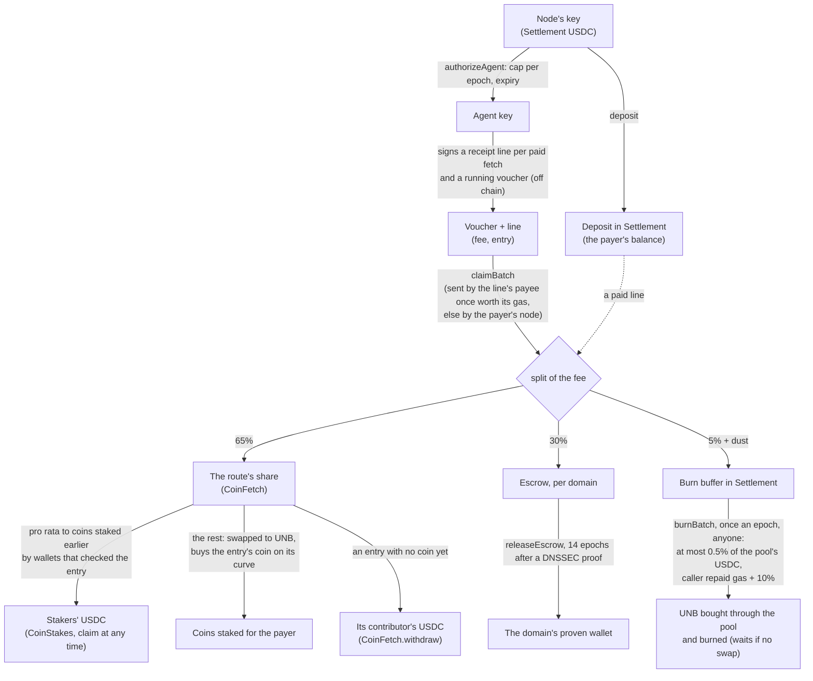

# Money: where funds are needed and where they flow

What a node pays for, who signs it, what it costs, and where a fee goes once an agent pays it. Written for an owner
running a node and an operator running a network. Every gas figure here was measured unless it says otherwise, and
the last section says how.

The compiled contract interfaces the node interacts with live in [`unbrowse-node/app/contracts/`](../unbrowse-node/app/contracts) (`LeanSettlement`, `Listings`, `Domains`, `RouteCoins`, `CoinStakes`, `CoinFetch`, `CoinBounties`). For the plain-English overview of route staking, earning from routes, and bounties, read [Payments, Staking & UNB](concepts/payments-and-unb.md) first. The node's side is [`unbrowse-node/app/src/`](../unbrowse-node/app/src):
`chain/` (every Settlement write), `erc8004.rs` (the identity), `listing.rs` (listing roots), `peers.rs` (joining
the network, holding) and `main.rs` (the owner commands and the background loop). The map of the whole system is
[ARCHITECTURE.md](ARCHITECTURE.md).

- [1. Three balances](#1-three-balances)
- [2. Every action that needs funds](#2-every-action-that-needs-funds)
- [3. Where money flows](#3-where-money-flows)
- [4. Sharing routes, and what a day of it costs](#4-sharing-routes-and-what-a-day-of-it-costs)
- [5. Paying your own way](#5-paying-your-own-way)
- [6. Decimals](#6-decimals)
- [7. Known gaps](#7-known-gaps)
- [8. How the numbers were measured](#8-how-the-numbers-were-measured)

---

## 1. Three balances

A node touches three kinds of money. Keep them apart: each comes from somewhere different.

| Balance | What it is | Pays for |
|---|---|---|
| **Gas** | Arc's native coin, which is USDC (18 decimals at the native level) | every transaction the node sends |
| **Settlement USDC** | the fee token named in the Settlement deployment (`Deployment.usdc`) | deposits, fees, claims, escrow |
| **UNB** | the token named in the same deployment (`Deployment.unb`): Unbrowse's own UNB on Arc mainnet, a test UNB elsewhere (§6) | buying and selling route coins, and bounties. Nothing is bonded |

All three sit at one address: the node's own key, the root key (`chain::owner_signer`). The code calls it the
*owner* key because it signs as the node's owner. It is an ordinary Arc wallet, and the node joins the network with it
with no sign-in (spec §86). A wallet the owner links (Privy, or their own) is a second one: it only signs the link
([ONBOARDING.md](ONBOARDING.md) §2), and receives withdrawals.

On Arc, Settlement USDC *is* Arc's own USDC (§6): its ERC-20 interface at `0x3600…0000` reads and moves the native
balance, so the gas and the Settlement USDC in the wallet are one balance, and a deposit moves part of it into
Settlement. Fees are the same money as gas: testnet USDC on arc-testnet, real money on arc-mainnet. On a devnet the fee
token is a test USDC of the devnet's own, apart from the gas.

---

## 2. Every action that needs funds

Every write is signed by the node's key. Agent keys sign nothing on chain: they sign the vouchers and receipt lines
off chain (`chain::running_voucher`), and a claim carries that signature to the contract.

**Before each write on a live network**, the node checks that it holds that write's own gas estimate at twice the gas
price (`chain::can_pay`, run as every write is sent, `rpc::mined!`). Below it the write isn't sent and the node says
where to get gas (`chain::needs_gas`). A claim is sized to what the node holds: as many lines as its gas pays for by
the claim model (`chain::claim_fits`), halved while the batch's own estimate is still more, down to one line, so a
short balance sends a smaller claim rather than none. A deposit never moves the gas a full claim batch needs out of
the wallet (`chain::claim_reserve`: the sending limit of a full batch on two entries, 6,230,625 gas, at twice the
price, **0.31 USDC** at 25 gwei), and the owner is told
when the node holds less than about one ordinary write, 1,000,000 gas (`WRITE_GAS`, `chain::gas_short`). A deploy
checks for 45,000,000 gas (`DEPLOY_GAS`) at twice the price, 2.25 USDC, before its first write.

There is no sponsor (spec §76): every write is the node's own, paid in USDC on Arc. Several calls of one write go as
one transaction through Arc's Multicall3From where the chain runs the batch (`rpc::batch`, §5), else one a call; the
figures in the tables are for each call sent on its own.

Costs below are at **25 gwei**, the gas price Arc testnet reported on 30 October 2026 (base fee at its 20 gwei floor
plus a 5 gwei tip). 100,000 gas is 0.0025 USDC. "Measured" means a real transaction's `gasUsed` on local Anvil (§8).

### Identity and the peer network

| Action | Call | Gas (measured) | ≈ USDC | When |
|---|---|---:|---:|---|
| Register the identity | `IdentityRegistry.register(agentURI)` | 338,938 | 0.0085 | Node, by itself, the first time it joins the peer network, from its own wallet (`erc8004::ensure`). Once per owner, ever |
| Record where it was registered | `setMetadata("unbrowse.registeredAt")` | 57,708 | 0.0014 | Node, with the rest of its metadata on joining, in one batch (`erc8004::publish`) |
| Publish the peer ID | `setMetadata("unbrowse.peerId")` | 103,066 | 0.0026 | Node, on joining (`erc8004::publish`) |
| Publish its addresses (3) | `setMetadata("unbrowse.addrs")` | 148,954 | 0.0037 | Node, on joining |
| Publish the client version | `setMetadata("unbrowse.version")` | 57,612 | 0.0014 | Node, on joining, and after each update |
| Publish the libp2p endpoint | `setAgentURI(uri)` | 191,743 | 0.0048 | Node, on joining |
| **First identity, all six** | | **898,021** | **0.0225** | |
| Addresses changed | `setMetadata("unbrowse.addrs")` + `setAgentURI` | 164,208 | 0.0041 | Node, checked every 30 s (`peers::RECHECK`); written only when they change |

A value already on chain isn't written again. A devnet that forks nothing has no registry and writes none of these.

### Listing

| Action | Call | Gas (measured) | ≈ USDC | When |
|---|---|---:|---:|---|
| List a route | none: a signed listing, kept and spread (R2.15) | 0 | 0 | `list_route`: the owner; automatic sharing (§4) |
| Post the listing root | `postRoot(root)`, any number of listings | 46,675 | 0.0012 | The reserve's poster, once an interval (R2.20); the node itself only when it knows no poster (`listing::publish`) |
| A body's first claim, showing its listing | `Listings.showAndClaim` | not re-measured on the route-coin contracts; about 130,000 more than a plain claim before them | | Whoever claims the body's first line: its payee, or the payer's backstop (R3.22). The first credits the entry and joins its contributor |
| Delist a credited entry | `delistEntry` | 34,618 | 0.0009 | Owner (`delist_route`); a listing no claim has shown is withdrawn between nodes, at no cost |
| Relist after delisting | `relistEntry` | 58,379 | 0.0015 | Owner (`list_route` of a delisted body) |
| Set the starting fee (optional) | `setFee(0.01)` | 45,424 | 0.0011 | Only a wallet that wants an on-chain fee; a listing lists its own price |
| Auto-reprice | `setFee(next)` | 28,292 | 0.0007 | Node, at most once an epoch, when auto pricing is on (the default) and a route is listed (`main.rs` `reprice`) |
| Set the fee by hand | `setFee` | 28,292–45,380 | ≤ 0.0011 | Owner (`set_pricing`) |

Listing posts nothing up front and there is no bond: the body's first claim credits the entry to its contributor.
Holding another node's route (`hold_routes`) writes nothing to the chain.

### Paying for others' routes

| Action | Call | Gas (measured) | ≈ USDC | Token | When |
|---|---|---:|---:|---|---|
| Allow Settlement to take USDC | none: a deposit is pulled under USDC's EIP-3009 authorisation (`depositWithAuthorization`), so no `approve` is sent | 0 | 0 | | |
| Deposit | `depositWithAuthorization(from, to, amount, validBefore, salt, sig)`, one call under the key's EIP-3009 authorisation; `deposit(amount)`, which needs an approval, is the other way in | not yet measured; `deposit` is 83,130 first, 48,930 after | about 0.002 | the amount, Settlement USDC | Owner (window Wallet, `deposit`); the node, by itself, up to `deposit_floor_usdc` (`chain::deposit`, `chain::top_up`, §5) |
| Ask to withdraw | `requestWithdraw` | 70,363 | 0.0018 | | Owner; it waits 2 epochs (`WITHDRAW_DELAY`) |
| Withdraw | `withdraw`, then `USDC.transfer` to the linked wallet if one is linked, in one batch (`chain::withdraw_to`) | 47,131 for `withdraw` | 0.0012 | the amount, to the owner's wallet | Owner, 2 epochs later |
| Send USDC on | `USDC.transfer` from the node's address to one the owner names (`chain::send_usdc`) | not yet measured | | what was paid to the node with no linked wallet, or any of its USDC | Owner (`wallet_send`), on the owner's yes |
| Authorise an agent key | `authorizeAgent(key, cap, expiry)` | 70,072 new; up to 125,891 re-authorising | 0.0018 | | Node, by itself, from when it goes on the network: every live key, and its own first key renewed before it runs out (`agents::keep_granted`); a key made by hand after sign-in at once (`agent_create`) |
| Revoke an agent key | `revokeAgent` | 31,466 | 0.0008 | | Owner (`agent_revoke`) |
| Claim one line | `claimBatch` of one | 474,056 used; sent with a limit of at least 2,329,070 | 0.012 | the fee, from the deposit | Node, when the claim is due (below); the owner's "Claim now" (`claim_now`) at once |
| Claim 10 lines on one entry | `claimBatch` | 1,012,185 (101,219 a line) | 0.025 (0.0025 a line) | the fees | the same |
| Claim 20 lines on one entry | `claimBatch` | 1,631,909 (81,595 a line) | 0.041 (0.0020 a line) | the fees | the same |
| Claim 40 lines on one entry | `claimBatch` | 2,889,087 (72,227 a line) | 0.072 (0.0018 a line) | the fees | the same; at most 40 a batch (`CLAIM_BATCH`) |
| Claim 10 lines on 10 entries | `claimBatch` | 3,505,067 | 0.088 | the fees | the same |
| Claim lines this node served | `claimBatch` | as above | | | Node, once the line's window is half over and its payer hasn't claimed it (`chain::claim_owed`) |
| Claim lines a payer handed this node as its watchtower | `claimBatch` | as above | | | Node, in the last quarter of the line's window, if it is still unclaimed and the lines pay at least the gas (`watchtower::claim_watched`) |
| Run the burn batch | `burnBatch` | 327,547 (forge, through the stand-in pool; not yet measured on Arc) | 0.0082 | repaid from the burn buffer: 450,000 gas at the base fee, plus 10% | Anyone, once an epoch; the node, from its claim loop (`chain::burn_batch`) |

There is one claim, `claimBatch`: a single line is a batch of one.

The fee itself never leaves the node as a transaction: an agent's paid fetch adds a line to its running voucher, and
the claim moves the fee from the deposit. A claim costs what it does because of what it does with the route's share:
for each entry and payer among its lines it pays the coin's earlier stakers in USDC, swaps the rest for UNB through the
pool, buys the entry's coin on its curve and stakes the coins for the payer (§3). That is done once for an entry and
payer however many of their lines the claim carries, so a line in a batch on one entry costs a fifth of a claim of one.
Settlement gives each of those calls all of its gas or reverts the claim, so a claim is sent with a gas limit well
above what it uses (2,329,070 at least for one line that used 474,056); gas a claim doesn't use isn't paid for, but
the wallet has to cover the limit. **Whoever sends a claim pays its gas**: a line's payee first, the payer for what the
payee left (below).

**When the node claims.** The claim model is `chain::CLAIM_GAS`: 155,000 gas a claim, 70,000 a line and 275,000 for each
entry and payer whose route share it sends (measured, §8). A line of epoch e can be claimed through epoch e + 1, and its claimers take turns (R3.22):

1. **Its payee first.** A serving node claims the lines it served as soon as they are worth its gas (`chain::claim_owed`):
   their gas, at the chain's gas price, is at most a tenth of what they pay (`claim_gas_share` in Settings, 0.1), they
   fill a batch of 40, or their epoch has ended, whatever they pay (`chain::claim_due`). A finished epoch takes no more
   lines, so waiting can't make its claim cheaper. At the default fee of 0.01 USDC a line never pays for its own claim,
   so a light day's lines go together just after the day ends.
2. **Then the payer, as the backstop.** The payer's node holds its own lines until the window's last epoch is half over,
   e + 1.5 (`chain::backstop_due`, `BACKSTOP_WAIT`), and then claims, by the same test, whatever no payee claimed: lines
   paying a wallet that only earns and has no gas, and lines whose receipt never reached their payee. A line a payee
   already claimed is seen spent and dropped. A server takes a payer's claim as overdue an eighth of an epoch after that
   (`chain::backstop_overdue`, `BACKSTOP_GRACE`) and stops serving it.
3. **Then its watchtowers.** The node hands each stream to them as it grows, and a tower claims what is still unclaimed
   in the last quarter of the window (`watchtower`, NETWORK.md §14), paying the gas itself, so lines are paid even when
   the payer's node is gone.

The owner's "Claim now" sends every line at once, whoever's turn it is.

**When a claim counts.** A claim's lines are marked claimed once the block holding the claim is final, not when its
receipt arrives (`rpc::finalized`). A claim whose block a reorg drops first fails, its lines stay open, and the next
pass claims them again. A line the chain shows spent in a block that isn't final yet is neither marked nor sent again
until it is (`rpc::SETTLED`). On Arc a block is final as it is committed, so this adds a read or two to each claim.
The same holds for deposits, withdrawals, coin trades, stakes and listings: each counts once final.

**A write the chain would take twice.** Most writes are safe to make again: a line is spent once, a root posted once, a
fee set to a value. A deposit, an identity's registration, a coin buy, a coin launch and a bounty post aren't, and a write can leave the node's
sight and still land, past its receipt timeout or across a restart. So each of these is signed first and kept in
`<chain>/sending.json` before it goes (`rpc::once!`, `inflight`). Until the chain says what became of it, nothing sends
that write again: a top-up, a registration or the owner asking twice reads the chain instead of a balance that hasn't
moved (`inflight::settle`), and the kept bytes go out again in case the chain never had them, which can't make a second
write. A kept write is let go once it lands and is written down, or once its nonce is taken or its bytes are refused and
that has held for three minutes. A write that sits unmined for five minutes holds back every write after it, so a no-op
at its nonce, at twice the fee, takes its place (`rpc::unstick`), and whoever made the write makes it again.

**A line nobody claimed.** A window that closes with a passed line unpaid can't be reopened, and the claim pass only
visits the two epochs still open. So once an epoch the node reads what the chain paid under each closed stream
(`chain::tell_lapsed`): lines a tower paid are marked claimed, and the rest are marked `lapsed`, with the owner told once
what they left unpaid.

Nothing vests. Waiting only moves when a line pays: a line a payee claims goes in the epoch it is signed or just
after, and one left to the payer's backstop as late as half way through the next epoch, so its coin is bought, and it
shows in its contributor's demand for auto pricing (`paid_since` reads claims), that much later.

### Earnings, route coins and a site's escrow

Coin calls were measured in the contracts' test suite (forge), not on a chain; where no figure is given none has been
measured yet. Every trade the node sends carries a least amount out and a deadline, and the node approves a contract for
exactly the amount it is about to take.

| Action | Call | Gas | Token | When |
|---|---|---:|---|---|
| Launch a listing's coin with its first buy | `RouteCoins.launch(entry, unb, …)` | about 309,000 (forge) | the buy, UNB | The node, when its listing is credited, with 1% of the wallet's UNB by default (`coin_dev_buy`; 0 turns it off); or the owner (`coin_launch`), on their yes in the node's window. Only the entry's credited contributor launches a coin; a bounty never does |
| Buy a coin | `RouteCoins.buy` | about 103,000 median (forge) | UNB; 1% fee, and a snipe tax in a coin's first 5 minutes | Owner only (`coin_buy`), on their yes in the node's window each time. A fetch's own buy needs nothing from the owner |
| Sell a coin | `RouteCoins.sell` | | UNB back, less 1% | Owner only (`coin_sell`), on their yes in the node's window each time; staked coins are asked back first |
| Stake coins | `CoinStakes.stake(coin, amount, delay)` | | | Owner (`coin_stake`); a lot per exit delay, 24 hours unless named. They earn from the next epoch close, once the wallet has checked the entry |
| Set the delay a fetch's coins are staked with | `CoinStakes.setFetchDelay` | | | Owner (`coin_fetch_delay`); 24 hours until set |
| Ask coins back | `CoinStakes.requestUnstake(coin, delay, amount)` | | | Owner (`coin_unstake`). They stop earning and counting at once and return after that lot's own delay |
| Take coins back | `CoinStakes.withdraw` | | the coins | Owner (`coin_withdraw`), once the delay has passed |
| Claim what a stake earned | `CoinStakes.claim(coin)` | | USDC, paid at once: nothing vests | Owner (`coin_claim`, or `collect_earnings` for everything waiting) |
| Take the route shares owed as a contributor | `CoinFetch.withdraw` | | USDC | Owner (`collect_earnings`): the route share of lines on the wallet's entries that had no coin to buy |
| Complete a held buy | `CoinFetch.completeBuy(coin, payer)` | | none of the caller's; the coins are staked for the payer | The node, for its own owner's held buys on each claim pass; anyone may for anyone |
| Sample a coin's price | `CoinFetch.poke(coin)` | | | The node, when a sample is due, for the coins its owner holds, so the next fetch's buy has a price to be held to |
| Prove a domain's wallet | `Domains.claimEscrow(domain, proof)` | 571,405 for a four-set chain (forge, a signed test zone); more for a longer one | | Anyone, with the domain's DNSSEC proof (R4.14). A domain without DNSSEC can't be proven |
| Release a domain's escrow | `Domains.releaseEscrow(domain)` | 71,504 median (forge) | the escrow, Settlement USDC, to the domain's wallet | Anyone, 14 epochs after the proof (`escrowWait`) |

There is no bond, nothing is withheld from a claim, and no write pays for quiet epochs.

### Bounties

`CoinBounties.sol`: a bounty is a limit order in UNB for a site's routes. The owner works bounties without calldata:
`bounty_post`, `bounty_confirm`, `bounty_settle`, `bounty_release`, `bounty_refund`, `bounty_list` and `bounty_show`
([CLI.md](CLI.md)), and the SDKs' matching methods. The node takes the bounty steps for the owner only once the owner
turns that on (`bounty_auto`; off by default).

| Action | Call | Token | Who |
|---|---|---|---|
| Post a bounty | `UNB.approve`, then `CoinBounties.post(site, amount, limit, deadline)` | the amount, UNB, held by the contract | Any UNB holder (`bounty_post`): `limit` is the most it pays a coin, fees and tax included; open 30 days unless named |
| Confirm an entry | `CoinBounties.confirm(id, entry, deadline, maxCost)` | buys the entry's coin within the limit and at most `maxCost` a coin, which the node sets to the curve's quote with 1% slippage, read when the owner allowed the confirmation and never raised for a retry, so a price pushed ahead of it, in its block or before the node's pass, makes it revert (`CostAboveMax`) and spend nothing, and the owner is told "price moved: wait, or post the bounty again with a limit". The node confirms on its own only with a cap kept from that yes: one allowed before the entry's coin traded needs a hand confirm (`bounty confirm`), or posting the bounty again with a limit; an entry with no coin is refused (`NoCoin`), since a bounty never launches one, and so is a coin still in its snipe window (`Unsteady`); the coins are split between the lister and the poster and staked for each in its own lot | The poster only, after its own paid call on that entry passed and was claimed since posting (`bounty_confirm`). A buy above the limit doesn't fill |
| Settle after the deadline | `CoinBounties.settle(id)` | fixes what use by others released: at most 5% of the USDC their counting lines paid while it was open, never more than the bounty | Anyone (`bounty_settle`) |
| Release an entry's share by use | `CoinBounties.releaseByUse(id, entry)` | buys that entry's coin within the limit, in proportion to the USDC its lines paid, and only while the coin's price is steady (within 1% of its 15-minute mean and of its settled price); refused otherwise, to be sent again later. What the limit doesn't fill stays the entry's for a later release. The share of an entry that had no coin when the bounty was settled goes to the poster, to take back, even if its coin launched since. A lister has to launch by the bounty's deadline to get the share. | Anyone (`bounty_release`) |
| Take back what is the poster's | `CoinBounties.refund(id)` | what a confirmation didn't fill, and after settling what nobody's use reserved | The poster (`bounty_refund`) |

Nothing burns a bounty for silence, nobody but the poster confirms, and a share that use earned waits for whoever
releases it: the poster's refund can't take it, even when its limit fills none of it. Only the share of an entry that had
no coin when the bounty was settled, left the site or lost its contributor is the poster's, once released.

A poster's node that already keeps an entry's route would run it free and never make that paid call. So while the
owner has an open bounty for the entry's site and no counting line of its own on the entry since posting, the node
pays that one call (`decide.poster-pays-once-to-confirm`, `autobounty::confirm_line_due`); after it, the kept route
runs free again. If the paid call can't start, the call runs free and nothing is held up.

### The operator's actions

| Action | Call | Gas (measured) | ≈ USDC | When |
|---|---|---:|---:|---|
| Deploy a network's contracts | on Arc testnet: test UNB, the pool, mint UNB, approve both, seed the pool from the deployer's USDC, then the domain proofs (whose constructor makes the DNSSEC verifier), the four route-coin contracts (`RouteCoins`, `CoinStakes`, `CoinFetch`, `CoinBounties`) and Settlement on Arc's USDC, in that order (`chain::deploy_as`). On Arc mainnet the test UNB's deploy and mint drop out, and the pool is the adapter over UNB's own | not measured on the route-coin contracts; the deploy checks for 45,000,000 gas | at most 2.25 held before it starts | Operator, once per network, by hand (`unbrowse-node chain deploy --pool <usdc> <unb>`, [OPERATIONS.md](OPERATIONS.md)) |
| Deploy a devnet's contracts | test USDC too, both tokens minted for the seed | not measured | | The devnet, by itself, when it starts |
| Deploy a replacement stand-in pool | `new UnbPool` | 1,241,575 | 0.031 | Operator |
| Add liquidity (first) | `addLiquidity` | 200,046 | 0.0050 | Anyone; the deploy seeds the pool with what `--pool <usdc> <unb>` names, the USDC from the deployer's own (never assumed beside Arc's USDC), and a devnet with 1,000,000 of each |
| Add liquidity (later) | `addLiquidity` | 103,363 | 0.0026 | Anyone |
| Remove liquidity | `removeLiquidity` | 76,223 | 0.0019 | A share holder |
| Mint test tokens | `faucet(to, amount)` | 36,122–70,366 | | Only the token's owner: the devnet's deployer, or whoever deployed it on a live network (`chain::faucet`). Arc's USDC and mainnet's UNB have no faucet |

Nobody can name another pool, change a route-coin number or bind a domain by hand: every one is fixed at deployment, and a domain's wallet is proven
with DNSSEC only (`claimEscrow`). A domain without DNSSEC can't be proven.

---

## 3. Where money flows

**A node's own routes are free to its own agents.** A route the node learned itself runs for its agents with no fee,
whether or not the node lists it: no voucher, no receipt line, nothing held under the key's cap, and no chain read for
the fee (`api/call.rs` `run_route`; R3.12, R3.34). Listing a route lets *other* nodes pay to fetch its body. The only call
that pays is a fetch of another contributor's body on a cache miss; a body already kept runs again for free.

**Deposit and vouchers.** The node's key deposits Settlement USDC (`deposit`) and authorises each agent key with a
cap per epoch and an expiry (`authorizeAgent`). An epoch is 24 hours of the chain's blocks (`epochBlocks`, R1.28). Each paid fetch adds a
receipt line to the agent's running voucher: the entry, the fee, and the node that served the body, written with the
line and never changed (`chain::Reserved::network_line`). Before the site is
called, the node checks the line fits under the key's cap and the deposit (`chain::reserve`). A voucher for epoch `e`
can be claimed in `e` and `e + 1` (`CLAIM_WINDOW`). A withdrawal waits two epochs, so every voucher's window closes
before the payer can leave.

**The claim and the split** (`_claim`, `LeanSettlement.sol`). Anyone may send a claim; it pays whom the line names, never
the sender. Each fee splits three ways, and nobody else is paid: there is no server's share and no platform's.

- **65% is the route's share** (`fees.contributor`, `coin.fetch-pays`). Settlement sends it to `CoinFetch` with the
  entry and the payer:
  - **To the coin's earlier stakers, in USDC.** Each coin of the fixed supply earns the same part of the share, and
    the coins that count are paid theirs: staked before this epoch's close by a wallet that has checked the entry (a
    passed, counting line of its own on it, served by another party; the contributor is checked when it serves one).
    Each staker's part adds to a running sum in `CoinStakes`, and `claim(coin)` pays it at once. Nothing vests and
    nothing is withheld.
  - **The rest buys the coin for the payer.** The part of the share that falls to coins not staked and checked is
    swapped for UNB through the pool and buys the entry's coin on its curve; the coins are staked for the payer in the
    lot of the exit delay the payer set (`setFetchDelay`, 24 hours until set). So the first payer's whole share buys
    coins, and the more of the supply is staked by wallets that check, the more of each fetch they are paid.
  - **A buy that can't be made at a fair price waits.** The buy goes through only within 1% of the pool's 15-minute
    mean price and of a settled price two blocks back, for the swap and for the curve; a coin too young to have a
    mean, or a price that has moved, leaves the USDC held for that coin and payer (`parked`), and anyone may complete
    it later for the payer (`completeBuy`). The node completes its own owner's.
  - **An entry with no coin** has nothing to buy: its route share is owed to its contributor in USDC
    (`CoinFetch.withdraw`), until someone launches the coin.
  - A call into the coin contracts that fails inside a claim never stops the claim: the route share waits in
    Settlement (`routeHeld`) and anyone sends it on (`sendHeld`).
- **30% to the website's escrow**, kept per domain in its canonical form. A site proves the wallet it is paid to with
  a DNSSEC proof of a TXT record at `_unbrowse.<domain>` reading `wallet=0x…` (`Domains.claimEscrow`, R4.14),
  the only way a domain is proven: a domain without DNSSEC can't be proven, and its share waits in escrow until it has
  DNSSEC and a proof is submitted (`domain status` says so in its `note`). 14 epochs later (`escrow.wait`)
  `releaseEscrow` pays it what accrued, and later shares go to that wallet as they are claimed (Settlement asks
  `Domains.payee`). Each host proves its own name. Until a domain proves, its escrow stays in the contract; nothing
  expires it (R4.16, OPEN).
- **The rest is burned**: the 5% burn share and rounding dust, so the three parts always sum to the fee. A claim adds
  it to the burn buffer (`burnBuffer`, `BurnBuffered`) and swaps nothing for it. Once an epoch anyone may call
  `burnBatch` (R4.6): it swaps the buffer for UNB through the pool, at most 0.5% of the pool's USDC reserve at a time,
  and burns the UNB (UNB can burn its own; a token that can't is sent to `0x…dEaD`). What the cap leaves waits for a
  later epoch. The caller is repaid from the buffer for 450,000 gas at the block's base fee, plus the 10% batch margin
  (`fees.batch_margin`; there is no relayer, spec §79); on Arc the gas is USDC, so no price enters it. A batch that
  can't swap reverts with the reason, so nothing moves and the epoch's batch is still to run. `BurnBatched` reports
  each batch, and `nextBurnEpoch` is the first epoch the next may run in. No USDC is ever sent to `0x…dEaD`. The node
  runs it from its claim loop when it is due, at a point in the epoch's first half drawn from its address
  (`chain::burn_batch`).

**A route's coin** (`RouteCoins.sol`). Each credited entry can have one coin: a fixed supply, sold on a
constant-product curve against UNB that never runs out and never moves anywhere else, so the curve is the coin's
market for good. Every trade pays a 1% fee, and a buy in a coin's first 5 minutes pays a snipe tax that falls from 50%
to nothing and is burned. Only the entry's credited contributor launches its coin (the node does it with the listing's
first buy, 1% of the wallet's UNB unless the owner changes it); a bounty never does.

**Staking** (`CoinStakes.sol`). Coins are staked in lots, one per coin, wallet and exit delay. A lot earns from the
next epoch close, and only while its wallet has checked the entry; it counts in the entry's rank by its delay, while
the wallet's own latest paid call on the entry passed. Asking coins back stops both at once, and they return after
that lot's own delay. Nothing is slashed, and nobody can take a stake but its wallet.

**What a failed call costs.** Nothing, whatever share of a payer's calls fail. A failed line pays nobody and takes
nothing from the deposit or the agent key's cap (`decide.failed-fetch-always-free`). The payer signs pass or fail
itself, so a payer that marks every call failed gets every answer unpaid, and nothing on chain stops it.

**What the node pays by itself, and what the owner sets.**

| By itself | Bounded by | The owner sets it with |
|---|---|---|
| Another contributor's fee for a route body | `max_fetch_usdc`, 0.05 USDC a fetch by default; a dearer route is passed over. A body already paid for is reused with no new payment | Settings, or `unbrowse-node max-fetch <usdc>` (0 pays for nothing) |
| An agent's fees in an epoch, for fetches of other contributors' bodies (the node's own routes count nothing) | the key's cap (`capPerEpoch`), and its expiry | When making the key: the node's own key, the window and `agent new <name> [cap] [days]` start at 5 USDC an epoch (`agent.key_cap`) and 30 days; the owner raises it with `agent cap <index> <usdc>` |
| All fees together | the deposit | `deposit`, `request_withdraw` |
| Its own fee | auto pricing: up a tenth after a busier epoch, down after a quieter one, between floor 0.0001 and ceiling 1.0 USDC | `set_pricing` (fee, auto, floor, ceiling) |
| Gas for identity writes, claims, repricing and coin writes (listing needs none, §4) | what the node holds; each write is sent only if the node can pay its own estimate, and a deposit always leaves the gas for a full claim batch (§2) | Topping up gas (§5); when the node claims (`claim_gas_share`) |

**What a wallet earned, by source** (`earnings`, `app/src/earnings.rs`; the window's Money, Earnings; `unbrowse-node
earnings`), in USDC, read from the chain's own events and balances: from staking route coins, its staked, checked
coins' part of each fetch on their entries, claimed and still to claim; as a contributor, the route shares the fetch
owed it for lines on its entries that had no coin, taken and still to take; and, for the owner to see where its
routes' money went, the route share its entries' lines sent to their coins, which is the coins' money, paid to whoever
stakes them. `collect_earnings` takes everything waiting.

**The currencies are fixed per deployment.** Fees are USDC and route coins trade against UNB (spec §41): on Arc
mainnet, Arc's USDC and Unbrowse's own UNB (§6). The contracts hold both tokens as `immutable`. The pool is the one
place the two meet. It is fixed at deployment, like everything else in Settlement and the coin contracts (R9.27,
R10.3): nobody can name another, so a real pool comes with a new deployment. No contract leaves a balance approved to
the pool.

---

## 4. Sharing routes, and what a day of it costs

Listing writes nothing to the chain (R2.15). The node signs the listing, with its price in the listing's terms, and
keeps it. A root holding its leaf comes from the reserve's poster, which posts one an interval over every leaf sent to
it (R2.20, `reserve.rs`), or from the node's own `postRoot` when it knows no poster; the listing spreads once the root
is on chain. The chain learns of the listing at its first claim, which carries it (`Listings.showAndClaim`) and
credits the body's entry to its contributor. A wallet with no gas lists, and is paid by the payer's backstop claim
(R3.22). `share_routes` has three modes:

- **`used`** (the default): the node lists only routes its agents keep using. A route has to have run successfully on
  3 different days, or 5 times (`DAYS_EARNED`, `RUNS_EARNED`). The most used go first, at most 5 listings a day.
- **`all`** (opt-in): every learned route is listed after its first successful run, at most 20 a day.
- **`off`**: nothing is listed. Turning sharing off delists nothing; `delist_route` delists one route, `delist_all`
  every one.

In every mode a route is listed at most 2 per minute's pass (`PER_TICK`). It is never listed if the owner set it
`share: false`, if it reaches an excluded site, or if its body would carry anything of the session. The owner can set
a different daily number (`list_per_day`). It no longer bounds gas, since listing costs none: it bounds how many routes
the node publishes for others in a day, so what the owner shares grows at a pace they can review (R2.8, R2.14a).

**What a listing costs.** Nothing, per listing. A root covers any number of listings: 46,675 gas (0.0012 USDC) when
the node posts its own, and nothing when the reserve's poster posts it. The body's first claim carries the listing,
which costs more gas than a plain claim, once (about 130,000 more before the route-coin contracts; not re-measured),
paid by whoever sends it.

**What the listing's first buy costs.** When a listing of the wallet's is credited, the node launches its coin with 1%
of the wallet's UNB at that moment and stakes the coins for the owner (`coin_dev_buy`; 0 turns it off). The launch is
one write, about 309,000 gas (0.0077 USDC), and the UNB it spends becomes coins the owner holds. A wallet with no UNB
launches nothing, and the route still lists and earns its contributor the route share.

| Mode | A day at the cap | A typical day (assumed) |
|---|---|---|
| `used` | 5 listings: nothing with the reserve's poster, one root (0.0012 USDC) without | the same |
| `all` | 20 listings: the same | the same |
| `off` | 0 | 0 |

Add up to 0.0007 USDC a day for auto-repricing once anything is listed, for a wallet that sets its fee on chain; a
wallet that never does prices by its listings.

**What a day's claims cost the payer.** A day of light use: an agent makes 20 paid fetches spread over the day, at
0.01 USDC each, 0.20 USDC in all.

| | Claims | Gas | ≈ USDC | Share of what they pay |
|---|---|---:|---:|---:|
| Each line claimed by itself | 20 claims of one line | 9,481,120 | 0.237 | 119% |
| One claim after the day ends, the lines on one entry | 1 claim of 20 lines | 1,631,909 | 0.041 | 20% |
| One claim, the lines on 20 different entries | 1 claim of 20 lines | about 7,055,000 | 0.176 | 88% |

The first two rows are measured; the third is the claim model's. A claim's cost is mostly its coin buys, one for each
entry among its lines, so lines at 0.01 USDC spread over many entries cost nearly what they pay to claim, and the node
waits for an entry's lines to gather: the payee claims first, and only once the gas is at most a tenth of what the
lines pay or their epoch has ended (§2).

---

## 5. Paying your own way

There is no sponsor and no faucet (spec §76): every write is paid by the node's own key, in USDC on Arc, which is also
Arc's gas. Nobody is sent USDC to spend.

- **A node that only earns** needs a few cents of USDC once, for its identity: the registration and the metadata saying
  where it is (§2). Listing needs no bond and no UNB. `funding` says it (`identity_usdc`, 0.05, `link::IDENTITY_USDC`), and the
  windows show it as "USDC for your node", and the node's health says it while it waits to join. When the node can't
  pay its gas as its owner links a wallet, it opens the link page with `fund=<chain id>` (`link::page`), and the page
  offers the owner one USDC transfer of that amount from their own wallet, which they sign or skip.
- **Gas:** send USDC on Arc to the node's address. On Arc testnet it comes free from Circle's faucet,
  https://faucet.circle.com (`arc::ARC_TESTNET.faucet`). USDC held on another chain arrives through Arc's own CCTP v2
  or Gateway: `funding` names Arc's CCTP domain, its TokenMessengerV2 and Gateway minter (`other_chains`).
- **Deposit:** an owner who holds USDC deposits it (window Wallet, "Add to deposit"), and the node tops its deposit up
  from its wallet by itself while it is below `deposit_floor_usdc` (`chain::top_up`), never moving USDC it doesn't
  have and always keeping `gas_reserve_usdc` for gas. A deposit is one call with no approval first: the key signs
  USDC's EIP-3009 authorisation for Settlement to pull it (`depositWithAuthorization`). `funding` says how much to send
  (`fund_usdc`). Withdrawals go to the linked wallet, if one is linked, else stay in the node's own, where collected earnings also arrive: there the top-up never moves them back into the deposit (`chain::to_deposit`, `<chain>/paid-out.json`), and `wallet_send` sends them on to an address the owner names, on the owner's yes (`chain::send_usdc`). Only a test USDC, on a devnet,
  is minted by its deployer (`chain::faucet`).
- **UNB:** needed only to trade route coins by hand, to make a listing's first buy or to post a bounty. A node that
  pays for fetches needs none: the fetch swaps part of the fee for UNB itself and buys the coin for the payer.

**What the node signs, and what bounds it** (security re-audit, 10 November 2026):

- **Allowances.** A token allowance goes only to one of the deployment's own contracts that pull tokens (Settlement,
  its domain proofs, its bounties), at the addresses the network file names, once Settlement on the chain names the
  same ones and the deployment check has verified their code (`chain::network::named_by_file`, `conform::check`). An
  RPC's word alone never chooses one: a file that names a contract Settlement doesn't is refused whole, and a
  contract the file doesn't name isn't used. It is for exactly what the one write pulls (a stake or a
  bounty post), an older unlimited one brought down to it, and whatever the write didn't
  pull is taken back once the chain has said what became of it (`chain::approve`, `chain::take_back_allowance`).
  Each is confirmed at the chain's final block: an approval that doesn't read back as its amount sends nothing that
  needs it, and a take-back that doesn't read as nothing is kept as owed (`<chain>/allowance-resets.json`), said to the
  owner, and taken back before any other approval is made.
- **Fees.** Every write's gas and fee are set by the node (`rpc::price`): twice the chain's base fee plus a tip,
  never more than `max_gas_price_gwei` (default 500 gwei, 25 times Arc's floor) a unit of gas, and no write takes more
  than `rpc::MAX_WRITE_GAS`. A base fee above the cap sends nothing. The tip is paid to the chain whatever the block's
  base fee, so an RPC that says the base fee is low and suggests a large tip could make every write pay up to the cap:
  with a second RPC named, the base fee and tip are each the lower of what the two say (`rpc::agreed_fee`), so one RPC
  alone never raises what a write pays. With one RPC, what remains is that RPC's word, held to the cap and the day's
  budget below: name a second RPC (`check_rpc`) to close it. On a live network every write takes its most cost
  out of `gas_budget_usdc_per_day` (default 5 USDC) before it is signed, brought down to what it cost once its receipt
  is in (`<chain>/gas-spent.json`); a write past the day's budget waits for the next day. A watchtower spends at most
  `TOWER_GAS_PER_PAYER_USDC` (0.05) an epoch claiming any one payer's lines by itself, by the signed most of every write the claim makes (its gas limit at the most fee a unit it is signed at), taken before each is signed; the payer's whole allowance is set aside on disk before the claim and only what its writes took is counted after, so a restart never gives a payer a fresh one.
- **The chain.** Every transaction names the chain the node runs on (the live network's own ID, or the devnet's as it
  answered when the node proved it its own), never the RPC's answer, and no write goes out while the RPC says it is
  another chain. The deposit's EIP-3009 domain is computed for that chain and must match USDC's own. The root key signs
  no hash an RPC hands it: the payer digest of a check is made by the node.
- **Once-only writes.** A deposit, stake, bounty post, registration or USDC send kept as out lands, or is let go, only
  on a proven receipt (`inflight::verdict`): its own, proven to have run or reverted, or another of the node's at its
  nonce. A receipt the block can't be shown to hold, whatever it says, leaves it waiting; no length of time and no
  RPC's word that its nonce is used lets it go. The owner, having looked at the chain, may let one go
  (`unbrowse-node chain kept`, then `chain kept release <key>`, asked in their own dialog, which says that a write
  let go that may still land can be paid twice).
- **What the node's RPCs can still do.** The node takes nothing about its own writes on an RPC's word. A receipt
  counts only when it is proven against its block (`proof`): the header rehashes to the block the receipt names, the
  block's transactions hash to its transactions root and hold the very bytes the node signed, and its receipts hash to
  its receipts root, from which the node reads whether the write ran and the gas it took. The block must also be on
  the finalized chain the node has followed itself (`anchor`): from its first look it keeps finalized heads, each
  linked to the one before by every header between them, rehashed here, and a proven block must be on the walk down
  from one of them. Nothing lands, nothing is let go and no gas is given back without both; a write whose fate can't be
  proven stays kept until a proof comes or the owner lets it go in their own dialog. Every answer a proof reads is
  bounded in size before it is decoded.
  - **A second RPC (`check_rpc`).** Here and below a *witness* is this second RPC standing behind a read, and a
    *witnessed* reading is one it answered alike at the same head; it has nothing to do with domains, which are proven
    by DNSSEC alone. With one named, the chain ID, every finalized head the node takes, every proven
    block's hash, and the balances and allowances its writes are judged by are read there too, and any disagreement
    stops every write until the node restarts; an RPC that only doesn't answer (a refusal, a rate limit, a block it hasn't yet) contradicts nothing, so the chain is just not followed that pass and the node reads again (`anchor::Broken`). A write is signed only once the node has followed the chain to its
    finalized head on that very call with the second RPC standing behind it: a second RPC behind, or not answering,
    and every write waits, and the owner is told (`rpc::followed_now`). The second stands behind a head only as its
    own: its finalized head must be within `anchor::HEAD_SKEW` (64) blocks of the first's, and hold the first's block
    there by the same hash. A first RPC that names an old finalized block, which an honest second still has and would
    answer for, is no head a witness stands behind (R9-CHAIN-1); the owner is told the two are apart.
    Code can't prove two operators independent: a
    second RPC under the first's registrable domain, or resolving to any address the first resolves to (another port of
    the same host, a DNS alias), is refused (`rpc::independent`), and whether the two that remain are really run by
    different operators is the owner's judgement.
  - **Every witnessed reading is made at that head.** An operation (a release, a claim pass, a reputation read)
    follows the chain's finalized head once, on that very call (`rpc::Head::follow`, `anchor::advance`), and makes
    every witnessed or agreed reading of it there (`Head::read`, `Head::call_agreed`; the single-shot
    `rpc::read_witnessed`, `call_witnessed`, `read_agreed`, `call_agreed` and `second_agrees_on_balance` follow a
    head for one read). Never at a block number the first RPC names alone; the second reads the same block. Whether a
    reading is witnessed is that result, obtained in the operation that acts on it, never whether a second RPC is
    configured: the epoch a voucher is held to, the floor, the reservation bounds of a release (lifted only when that
    release's own epoch reading was witnessed) and every record cleared on a reading all take it from there. A paid
    release follows one head; a claim pass one to screen and one after it sends.
  - **A head is kept a few seconds.** A followed head is read at for `rpc::HEAD_LIFE` (5 s, well under one RPC
    request's 30 s timeout); past it no witnessed or agreed reading is made at it, and a long pass follows a new one
    (`Head::renew`). A release is held to `share::RELEASE_DEADLINE` (10 s) in all, its chain reads included, so one
    reply held back can't stretch it. Right before it reserves and serves, a release reads the finalized height again
    in one call (the second RPC's own, or the node's RPC's with none named) and refuses a voucher whose window has
    closed at it (`network::still_open_now`): a reply held back across an epoch boundary can't have the release's
    earlier snapshot serve a voucher the chain stopped paying (R11-CHAIN-1). That check is the last thing a release
    awaits: every other read it makes comes before it, and from it to the
    bytes going out only local work runs, the reservation and the activity line, so no reply held back can carry a
    release past the voucher's closing epoch once it was judged open (R12-CHAIN-1). The other places a voucher or line
    is taken against its window serve nothing after it: a line sent back for a body already served (`accept_receipt`)
    and a tower's hand-over (`watchtower::hold`) end in local books, where a line past its window is only a line no
    claim pays, let go by the witnessed epoch like any other.
  - **Which head, when the two differ.** The second's own head may be up to `HEAD_SKEW` blocks from the one both
    stand behind. Where a stale head would help an attacker, the more advanced of the two is taken (`Head::latest`):
    the epoch an expiry is judged by is the later of the contract's epoch at the agreed head and the epoch at the
    second's own head (`chain::epoch_at`, `block / epochBlocks`, at most one epoch on), and the floor rises to it, so
    a first RPC just behind an epoch boundary can't let in a voucher the chain already won't pay (R10-CHAIN-1). Where
    being behind is the conservative side (room under a cap, a deposit), the smaller reading is taken. With a second
    named and no head it stands behind now, a paid release is refused before any work.
  - **Reputation** (route ranking for paid calls, `chain::reputation_history`): read only up to the head the node
    followed, agreed by the second when one is named (`history_head`), every log range compared with the second's
    logs over the same blocks (`gas::agreed_logs`), into a copy kept only once all of it agrees, so no unverified
    event is ranked on (R10-CHAIN-2). A disagreement keeps the last agreed record and tells the owner (in the activity
    log, and in health's chain line for as long as it lasts); the same blocks are read again after a backoff (30 s,
    doubling, at most 15 minutes apart), and reading goes on once the two agree, with no restart. Past an hour of
    continued disagreement the ranking is unavailable: routes are ordered with no reputation rather than on a record
    that old, and the fee and payer caps still bound what a call spends (R11-CHAIN-3).
  - **Logs are read within caps.** Every `eth_getLogs` answer, for reputation and for every other log the node reads,
    is fetched as a stream and never decoded past `MAX_LOG_BYTES` (8 MiB) or `MAX_LOGS_PER_WINDOW` (10,000) logs
    (`gas::window_logs`); an answer over either is dropped, its window halved and asked again down to 16 blocks, and
    past that the read gives up and nothing it would have changed is kept. A whole read is held to 200,000 logs. Two
    RPCs' logs are compared window by window (R11-CHAIN-2).
  - **With one RPC on a chain reached over the network**, the node holds back every write that must not go twice
    (deposits, stakes, bounty posts, its registration, USDC sends) and gives back no gas it set aside, since whether
    such a write landed decides whether it is signed again (`rpc::Signs::Once`); it says so once, in its health, and in
    its chain status (`second_rpc`, `held_back`). Ordinary writes (claims, fees, listing roots, grants, withdrawals,
    allowances: each harmless made again, or capped by its contract) still go, each proven against the chain the node
    follows through that one RPC: no weaker than before the node proved anything, when it took that RPC's receipts on
    its word. A chain on this machine (the devnet, a node of the owner's own) needs no second RPC.
  - **Nothing is forgotten on one RPC's word.** An ordinary write may go on one RPC, but what its proof or a reading
    says is never written into the node's books as settled unless more than that RPC's word stands behind it: a
    second RPC standing behind the head the node just followed and agreeing at it, or a chain on this machine. A
    record is cleared only by a value that was itself read with a witness (`rpc::read_witnessed`); that a second RPC
    is named never stands in for that reading.
    Each place a one-RPC answer used to change durable state, and what a lying RPC can now make the node forget:
    - *Its own claims* (`chain::claim`, receipts): a line the claim's receipt, or the contract's `spentLine`, says is
      paid is marked claimed only when a witness reads it spent; otherwise it is kept *unwitnessed*: still owed against
      the deposit, picked by the next claim pass (sent again whenever it reads unspent; the contract refuses a second
      payment, so that is safe), handed to towers, and the owner told in the activity log. A stream whose window
      closed is recorded paid or lapsed only on a witnessed `claimedOf`; with none, its lines are marked neither, kept
      unwitnessed, and read again an epoch later (`settle_lapsed`). Nothing.
    - *Lines it served* (`chain::claim_owed`, `owed.json`): let go only when a witness reads them spent or past their
      window. A line only the one RPC says is paid stays owed and isn't sent again while it reads so; one only the
      one RPC says is past its window is set aside in `unwitnessed.json` (so `owed.json` stays as small as the open
      windows), never dropped, and put back among the owed on the first pass a witness can read it (by key, in time
      linear in the lines). A payer is refused for a skipped backstop only on witnessed readings. Nothing. The books
      are bounded by taking on no more, never by dropping a line: with one RPC on a chain over the network, a node
      holding `MAX_HELD_LINES` (10,000) served lines, owed, set aside and still to come together, releases no more
      bodies against payment and tells the owner to name a second RPC, which settles the lines it holds. A line still
      to come is a body released whose payer hasn't sent its line yet: its note in `served.json` is the line's
      reserved place, counted and written in one step under the ledger's lock before the body goes out
      (`network::reserve_served`), and a line is kept only against such a note, which it takes (`chain::owe`), so
      keeping it never adds to the count and a line already served is never refused for want of room. Within the
      ceiling, one payer and one agent key may hold at most 500 places each (`MAX_PENDING_PER_PAYER`,
      `MAX_PENDING_PER_AGENT`): a payer that takes bodies and sends no lines is refused at its share, the owner told
      which payer and key hold them, and every other payer is still served; its notes settle as its lines come.
    - *Served notes* (`served.json`): the evidence that the node released a body, which its payer's line is kept
      against. Pruned only once a witnessed epoch puts them past their window (`chain::seen_epoch`, the latest epoch
      read through `rpc::call_witnessed`), never on the one RPC's epoch, which could otherwise erase the evidence of
      bodies already served. Nothing.
    - *The witnessed epoch floor* (`epoch-floor.json`): the highest voucher epoch a witness stood behind on this
      deployment, kept on disk so it outlasts a restart, and only ever raised (`chain::epoch_floor`). No body voucher
      past its window by that floor, or by a witnessed epoch read as it is checked, is served, whatever the one RPC
      says the epoch is; with a second RPC named, a voucher is served only when a witnessed epoch can be read then,
      and a contradiction refuses it (`network::voucher_open`). A floor file that doesn't read serves nothing.
    - *Spent vouchers* (`spent-vouchers.json`): pruned only once the floor is past their window, so a voucher whose
      entry is gone is refused by the floor: the two together leave no voucher a second body, across restarts too.
    - *Refusals* (`refused-payers.json`): a refusal stands until the witnessed floor reaches its end, counted from the
      later of the epoch given and the floor; one for an overdue backstop is lifted early only when its line reads
      spent with a witness (`chain::line_spent_witnessed`), never on the one RPC's `spentLine`. With one RPC and
      nothing witnessed, a refusal stands: a denial of that payer, never one ended by a lie. Nothing.
    - *What the first RPC still decides for a release, in the moment*: whether the payer authorised the agent
      (`check_agent`), whether the listing is posted and live (`listing::verify`), whether a backstop is overdue, the
      head-side of the cap and deposit, and, for a line sent back, its key, entry and fee. The cap, what the epoch has
      paid and the deposit are also read at the followed head, agreed by the second RPC when one is named
      (`agent_room`, `exposure`), and the less room of the two is taken, so the first alone can only shrink it. With one
      RPC, a lie in these can serve a body whose line the chain won't pay, or turn a payer or a line away; it clears no
      record, and a line turned away keeps its note and can be sent again. What bounds that is the count of bodies,
      not money: each distinct signed voucher (a nonce) buys at most one body, never a second (the spent set and the
      floor hold it), but a payer may sign as many vouchers as it likes, each for a body's fee, so it is not one body
      in all and not a cap in USDC. The bodies whose lines haven't come are held to 500 for one payer or one agent key
      and 10,000 in all, after which the node takes no more paid releases until those lines come or a witness lets
      their notes age out.
    - *Reputation, with one RPC*: the history routes are ranked by (its uses, credits, delistings, fees) is that RPC's
      logs, on its word. A lie can reorder which route a paid call picks; what a pick can spend is still held by the
      agent key's cap, the payer's deposit and the route's listed fee.
    - *Lines it holds as a watchtower* (`watching.json`): a line the one RPC says is spent is kept and not sent until
      a witness reads it spent, and a line goes as past its window only by a witnessed epoch; one only the one RPC
      calls past it is neither tried nor dropped, held within the store's bounds (which refuse new hand-overs, not old
      lines). Nothing.
    - *The court book* (`court.json`): a juror's vote (its salt) and a reporter's case leave the book only when
      witnessed reads of the epoch and the case give the same step; a reveal's receipt alone no longer drops the
      vote. Nothing.
    - *Allowance resets* (`allowance-resets.json`): cleared only when the allowance, read with a witness, is nothing. On one
      RPC's reading of nothing the reset is kept, read again before every approval, and the owner told; nothing
      waits on it. Nothing.
    - *Revokes owed* (agent keys): let go only when the key's grant (`agentOf`), read with a witness at the final
      block, pays nothing (`chain::grant_pays_witnessed`); a first RPC that says revoked while a named second reads it
      paid stops every write and leaves the revoke owed. Without such a reading it stays owed, and it is sent again
      whenever the key reads paid. A lying RPC can still make the node revoke one of
      its own keys locally by reading it revoked on the chain (a denial: the owner makes a new key), never keep a
      revoked key paying. A grant's recorded transaction is only shown; whether a key is granted is read again each
      pass. Nothing.
    - *Withdrawals* (`paid-out.json`): a withdrawal with no linked wallet adds what it withdrew to the sum paid out
      at the node's address. A fabricated withdrawal receipt can make that sum too high, so `top_up` leaves more of
      the address alone than is there; the money itself stays in the contract (the deposit is read again before
      the next withdrawal), and a USDC send waits for a second RPC. A wrong number shown, never earnings forgotten.
    - *Gas counts and the tower's gas book* (`gas-spent.json`, `tower-gas.json`): a write's cost is given back only on
      an agreed proof, and the tower counts each claim at its signed most. Nothing.
  - **Two RPCs that lie together.** Two RPCs run by one party, or both taken over, from the node's first look on, can
    show the node a chain of their own making. On it they can make a once-only write look landed (the node then sends
    nothing more for it: a delay, never a loss), or look reverted, and the node would sign it again while they hold the
    first: two deposits or two coin buys (both the owner's, in the owner's own accounts), two bounty posts (both held in
    the owner's name, and each the owner's to take back), or, for a USDC send, a second payment to the
    address the owner named. They can also make a write look cheaper than it was, so the day's gas count runs under
    what was spent, by at most the fee cap on each write. Naming two endpoints of independent operators is what
    stands against this; the node can't verify consensus itself.
  - **The limits that remain, accepted.** Three, and only these:
    1. *A fabricated initial checkpoint on first look with one RPC.* A node's first look at a chain (a new chain
       folder, or a new run after a gap longer than `anchor::MAX_LINK`) takes the finalized head its RPC shows; with
       no second RPC named nothing can tell a self-consistent chain of that RPC's own making from the real one. On it
       the RPC can deny service and lie on reads, and make an ordinary write look landed; it can no longer make the
       node forget a line, a reset or a revoke (above), and every once-only write waits for a second RPC.
    2. *Two colluding RPCs.* Two RPCs run by one party, or both taken over, can agree on headers, receipts and
       readings of their own making (below). Endpoint checks refuse a shared registrable domain or a shared resolved
       address, but can't see common ownership behind distinct ones; the headers are checked for integrity, not
       verified as a light client would.
    3. *The DNS cache window.* Whether the two RPCs share an address is read from DNS and kept for ten minutes
       (`rpc::independent`): a name that moves onto the first RPC's address within that window passes until the
       check runs again.
  - **An RPC that withholds.** One that stops answering, or answers late, delays every write and every proof. A gap in
    the finalized chain longer than the node can link (`anchor::MAX_LINK`, about an hour of Arc's blocks, as after a
    node that was off) starts a new run of checkpoints, and a write that landed in the gap can never be proven: it
    stays kept until the owner, having looked at the chain, lets it go. Letting go a write that did land, or later
    lands, is the owner's own risk of paying it twice, and their dialog says so.
- **One signer a chain folder.** A node takes its chain's folder (`<chain>/node.lock`) for its whole life, and a second
  process on it is refused at start; `chain deploy` and the shell's `agent create` take it too, and leave signing to a
  running node. Every money file (the day's gas count, `sending.json`, receipts and owed lines, the paid-out sum, the
  watchtower's store and allowance, the stake book and the bounty memory) is changed only under its own
  lock across processes (`store::hold_money_file`), held from the read to the write; a lock that can't be had within
  ten seconds refuses the change.
- **Settings.** Any change that lets the node spend more, sooner, or on another chain (`store::SPENDING`: every
  cap, budget, floor and reserve above, the gas cap and budget, the routes listed a day, the chain) is asked in the
  owner's own dialog.

**Batches.** The calls of one write (the identity's metadata; a withdrawal and its transfer to the owner) go as one
transaction through Arc's Multicall3From, which keeps the node's key as each call's sender, where the batch runs as a
call there (`rpc::batch`). On a devnet, which has no Multicall3From, or a devnet forking Arc, which has its code but not
Arc's CallFrom precompile, each call is its own transaction.

---

## 6. Decimals

Each token is counted in its own decimals. Settlement's USDC counts in what its deployment records
(`Deployment.usdc_decimals`, read from the token's `decimals()` when it is deployed and again when a node takes it):
6 for Arc's own USDC as an ERC-20, 18 for a devnet's test USDC. UNB counts in 18, and so does the native gas (Arc's gas
is USDC, 18 decimals at the native level). The helpers name their unit: `usdc_units` and `usdc_fee_units`, `usdc_f`
(or `Deployment::usdc_units`, `fee_units`, `usdc_f`), `unb_units` and `unb_f`, `gas_units` and `gas_f`. A sum turns
into units from the decimal it is written as, never by multiplying a float.

Rounding never goes past the owner's own setting. A fee rounds up, so a contributor is never paid less than it set. A
cap, a deposit, a withdrawal or the most the node pays for a fetch rounds down, so no more moves or is allowed than
the owner said. Receipt lines hold the fee as whole USDC as the chain said it, so a line's units are that fee's
exactly. A voucher's total is the sum of its lines' units, and a receipt file an 18-decimal devnet kept before decimals
were recorded makes the same lines it always did.

Both `arc-testnet.json` and `arc-mainnet.json` name Arc's USDC, `0x3600…0000`, under `existing.usdc`
(`unbrowse-node/app/networks/`; mainnet's address and decimals were read from its RPC). Neither file names a UNB. On
mainnet UNB is Unbrowse's own, 18 decimals, and the operator names it on the deploying machine with
`UNBROWSE_ARC_MAINNET_UNB`, which overrides the network file's `existing.unb` (the general form is
`UNBROWSE_<NETWORK>_<USDC|UNB|POOL>`, `chain::network_file`). So
`unbrowse-node chain deploy` on mainnet, with that and UNB's v4 pool named (`UNBROWSE_ARC_MAINNET_V4_*`), puts the
adapter `V4UnbPool` over UNB's own pool and builds Settlement on it, seeding nothing ([OPERATIONS.md](OPERATIONS.md) §3). Where no UNB is named, as on arc-testnet, it deploys the test
UNB. How much goes into the pool is set at deploy: `--pool <usdc> <unb>` seeds it with that much of each. A token
the network names comes from the deployer's own balance; only a test token is minted, and on mainnet nothing is
seeded. A deploy beside a named token with no seed, or a seed the deployer doesn't hold, is refused before anything
is sent. A UNB that isn't 18 decimals is refused. Mainnet is not deployed yet.

What that means:

- On Arc, **gas, fees, deposits, claims, escrow and earnings are all the same USDC**: testnet USDC on arc-testnet, real
  money on arc-mainnet.
- A devnet keeps a test USDC of 18 decimals of its own; `UNBROWSE_DEVNET_USDC_DECIMALS=6` makes a new devnet's test
  USDC count as Arc's does.
- The fee token is fixed per deployment. A network with a deployment on a test USDC moves to Arc's only by a new one.

---

## 7. Known gaps

Found while measuring.

- **A claim's first write to fresh storage costs more.** The first claim that pays a new coin or a new payer's stake
  writes storage fresh, which the claim model doesn't count; the write's own estimate still guards the gas (§2).
- **A claim's batch is one agent's lines for one epoch.** Lines of several agents, or of two epochs, are claimed in
  separate transactions, each paying the call's part. `claimBatch` takes different vouchers, so they could share one.
- **A failed call shows nothing on chain** (`decide.failures-reported-off-chain`, the owner's decision of 12 Nov
  2026). The node claims no failed line and sends no `CoinStakes.reportFailed`. It reports a failed fetch to the
  telemetry worker and, when the owner has reports on, as a public issue through the report relay. So stake behind a
  route that broke keeps counting toward its rank until its holder sells or reports the failure itself, and the chain
  carries no record of a route's failures; each node still demotes a route that failed it in its own picks.
- **A payer that marks good calls failed pays for nothing** (`decide.failed-fetch-always-free`, accepted by the owner
  on 12 Nov 2026). The contract charges no failed line and keeps no count of failures, so a payer can sign "failed",
  keep the body and pay nobody, as often as it likes. Nothing on chain bounds it. A voucher still carries the payer's
  own `lines` and `passedLines`, which the contract doesn't read. A server keeps every line it serves, failed ones
  included, never claims a failed one, and stops serving a payer whose counts contradict the lines it holds
  (`network::accept_receipt`). That refusal is each server's own choice, read from what it saw, with no record on chain.
- **A deposit pays the first claims made on it.** Lines are paid in the order they are claimed, so a payer holding a
  server's unclaimed line can sign lines to an entry of its own and claim those first, leaving nothing in the deposit
  or under the key's cap for the server's line. The route share of those lines, 65%, buys the entry's coin for the
  payer, and the rest goes to the site and the burn. The contract stays as it is (issue #181), and a server guards
  itself.
  - *Covered:* before it releases a body, a server checks the deposit against the payer's whole outstanding. That is
    the body's stream, at the highest `cumulative` of the vouchers it holds plus this fee, less what is claimed of
    it, plus what the payer's other streams owe this server. The stream must also fit under the key's cap
    (`chain::covers`, in `verify_body_voucher`). It used to check one fee.
  - *Covered:* a server claims a payer's lines at once, whatever the gas, when that payer's headroom falls below what
    it owes this server (`chain::claim_early`, in `chain::claim_owed`). Headroom is the deposit left past a stream's
    signed total and the payer's other lines to it. Otherwise it waits until the lines are worth their gas.
  - *Left open:* a server sees a stream only as far as the latest voucher it holds. Lines the payer signs after it,
    on that key or on another, can still be claimed first, so a server can lose the lines it holds, bounded by what it
    served since the vouchers it checked. Issue #181 stays open for that.
- **A fee raised between signing and claiming makes a paid line count for nothing.** A line counts (R4.33) only when
  it pays at least its contributor's fee, and the chain reads that fee when the line is claimed, not when it was signed
  (`feeOf` in `LeanSettlement._claim`). A line signed at the old fee and claimed after a raise is still paid and still
  buys its coin, but it is no use of the route: it checks the entry for nobody, so the payer's stake there doesn't start
  earning from it; it lets no bounty be confirmed and adds nothing to a bounty's release by use; and it credits no
  listing (`Listings.creditPaid`). Fixing it needs the fee as it stood at the voucher's epoch. So a contributor should
  raise its fee only with notice, and a poster about to confirm a bounty should claim its call before a raise lands.
  Auto pricing raises the fee by up to a tenth an epoch with no notice (`main.rs` `reprice`).
- **A wallet the chain can't link to an entry's contributor is another party** (accepted). The contracts tell one party
  from another only by the agent keys that signed for a payer (`LeanSettlement.controllerOf`). A line its contributor's
  own party paid is paid but counts for nothing. A contributor that pays its own entry through a wallet the chain can't
  link has those lines count: they check the entry for that wallet, open the listing's credit window and add to a
  bounty's release by use. Each such line costs it the site's 30% and the burn's 5%, and a bounty releases by use at
  most 5% of the USDC those lines paid, so the wash costs seven times what it can release.
- **A by-use share under a limit the price has passed never fills.** It stays reserved for its entry and is not the
  poster's to take back, so a poster who sets a limit should expect to lose that part if the coin's price stays above it.
- **A parked buy can be bought ahead of, within 1%.** A fetch's buy that waits (`parked`) is completed later at the
  price then. Anyone but the payer completes it only at or below the settled price of two blocks back, so nobody can
  push the price and complete in one transaction; a buyer who holds a position in the open for two blocks can still
  sell into the completed buy, for at most the 1% drift the buy allows.
- **The curve's 1% trade fee goes to one address fixed at deployment** (`fee_recipient_of`), which has no other power:
  the owner's wallet, named on the deploying machine and written in no file here (`decide.trade-fee-to-owner`).

---

## 8. How the numbers were measured

- **Settlement, the pool and the tokens:** `bash unbrowse-settlement/script/gas/settlement-gas.sh`. It starts a local
  Anvil, deploys the node's own embedded artifacts (`unbrowse-node/app/contracts/*.json`) in the order `chain::deploy_as`
  sends them, and sends each write in the shape the node sends it, printing the receipt's `gasUsed`. Claims are signed
  as the node signs them: one line, its own root, the agent key over `voucherDigest`. `USDC_DECIMALS=6` runs it on a
  test USDC of Arc's 6 decimals; every write then costs the same to within about 70 gas (shorter calldata), so the
  figures here hold for both. The deploy on Arc's USDC is the same run without the test USDC's deploy and mint.
- **The identity:** `bash unbrowse-settlement/script/gas/identity-gas.sh`. It starts a local Anvil that forks Arc
  testnet, so the real ERC-8004 IdentityRegistry's code runs, and sends the six writes `erc8004::ensure` and
  `erc8004::publish` make. It uses the node's registration file, percent-encoded as the node does it: 266 bytes to
  register, 425 with the endpoint, and three listen addresses. Every transaction goes to the local fork; the fork only
  reads the registry's code from Arc's RPC.
- **Claims as the node sends them:** `UNBROWSE_DEVNET_FORK=none cargo test -p unbrowse-node-app claim_gas --
  --ignored --nocapture` in `unbrowse-node`. It starts a devnet of its own and has the node claim 1, 2, 5, 10, 20 and
  40 lines on one entry with a coin, each claim buying the coin for the payer, then 10 lines on ten entries, and
  prints each receipt's `gasUsed` beside the claim model (`chain::CLAIM_GAS`). It fails if any claim takes more than
  the model or the model drifts far above it. Run on 12 November 2026 on the route-coin contracts: 474,056, 528,093,
  715,471, 1,012,185, 1,631,909, 2,889,087 and 3,505,067 gas. The devnet swaps through the stand-in pool; through the
  adapter over UNB's own pool a swap takes about 74,000 gas more.
- **Route-coin calls:** `forge test --match-path 'test/coins/*' --gas-report` in `unbrowse-settlement`. The launch and
  the curve buy in §2 are its medians. No other coin call has been measured, on a chain or off.
- **What was not measured again.** The identity, listing, deposit, withdrawal and agent-key rows of §2 were measured on
  30 October 2026, before the route-coin contracts; those functions didn't change with them, but
  `settlement-gas.sh` has not been run on the new deployment.
- **The gas price:** read-only `eth_gasPrice` (25 gwei) and `eth_feeHistory` (base fee 20 gwei in each of the last 20
  blocks) from Arc testnet's RPC on 30 October 2026. No transaction was sent to any live chain.

Gas used depends on the string lengths (domain, description, addresses) and on whether the storage was touched before.
The figures are for the shapes above; a long description or many addresses cost more.
