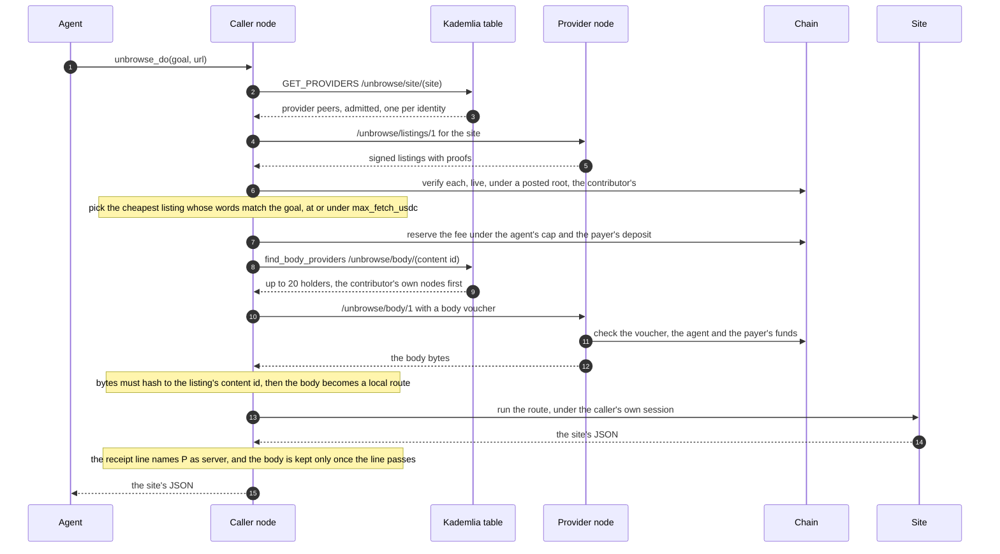

# The peer network

How nodes find each other and each other's routes, who counts, how a route's body moves between them, and what a node
does when the chain or a peer stops answering. Written for engineers changing the network code and operators running
nodes on a live chain. What a listing is and what a body may carry is in [SHARING.md](SHARING.md); what any of it costs
is in [MONEY.md](MONEY.md).

The code is in two places. [`unbrowse-node/crates/net`](../unbrowse-node/crates/net) is the swarm: Kademlia keyed by
site, admission, positions, reachability and the wire protocols. It never reads a body or the chain. The node's side is
[`unbrowse-node/app/src/`](../unbrowse-node/app/src): `peers.rs` (joining, publishing, answering listings, holding),
`erc8004.rs` (the registry), `share.rs` (serving and fetching bodies), `network.rs` (body vouchers, receipts, node ads)
and `main.rs` (`join_peers`, the background loop). The design is spec §52 and §53 in the papers (protocol R7.18 to
R7.26). The crate's own [README](../unbrowse-node/crates/net/README.md) is the short form of the first half of this
page.

- [1. The swarm and its protocols](#1-the-swarm-and-its-protocols)
- [2. Who counts: admission](#2-who-counts-admission)
- [3. Joining](#3-joining)
- [4. Site keys and provider records](#4-site-keys-and-provider-records)
- [4a. Going offline](#4a-going-offline)
- [5. The listings protocol](#5-the-listings-protocol)
- [6. The body protocol and vouchers](#6-the-body-protocol-and-vouchers)
- [7. A fetch across nodes](#7-a-fetch-across-nodes)
- [8. Seeding, light mode and the dark set](#8-seeding-light-mode-and-the-dark-set)
- [9. Being reached: NAT, relays, addresses, the peer port](#9-being-reached-nat-relays-addresses-the-peer-port)
- [10. Opting out](#10-opting-out)
- [11. What each node publishes](#11-what-each-node-publishes)
- [12. Failure behaviour](#12-failure-behaviour)
- [13. Not built yet](#13-not-built-yet)

---

## 1. The swarm and its protocols

`Net::start_with` (`crates/net/src/node.rs`) builds one libp2p 0.57 swarm under the node's Ed25519 key. The
transports are TCP with Noise and Yamux, and QUIC. Connections idle for 120 s are closed.

| Protocol | Name | What it carries | Bounds |
|---|---|---|---|
| Kademlia | `/unbrowse/kad/1.0.0` (`KAD_PROTOCOL`) | the routing table and provider records. A private name keeps Unbrowse peers in their own table | k = 20, α = 3, disjoint query paths |
| Identify | `/unbrowse/id/1.0.0` | listen addresses, supported protocols, and the agent version `unbrowse/<release>` | |
| Hello | `/unbrowse/hello/1` | the peer's `Claim`: its identity and which of the identity's nodes it is (`index`) | 4 KiB each way |
| Listings | `/unbrowse/listings/1` | a site's signed listings, JSON | ask 4 KiB, answer 256 KiB, §5 |
| Body | `/unbrowse/body/1` (`BODY_PROTOCOL`) | one body by content id, with its payment, raw bytes | §6 |
| Tower | `/unbrowse/tower/1` (`TOWER_PROTOCOL`) | one stream's signed running voucher and passed lines, handed to a watchtower, raw bytes (JSON `PaidLine`s to the node) | 256 KiB a hand-over; answer 1 byte and a reason of at most 512; 8 checked at once; each peer a burst of 16, then one every 5 s; §14 |
| Leaving | `/unbrowse/leaving/1` | a stopping node's signed goodbye, JSON (§4a) | 4 KiB each way; answered within `goodbye_within` |
| Changes | `/unbrowse/changes/1.1.0` (`CHANGES_PROTOCOL`), gossipsub | a contributor's signed notice that it delisted or repriced entries, one topic a site (§15) | 4 KiB a notice, 32 entries; each source 64, then 1 a second |
| Ping | libp2p's | a liveness check on every connection as it opens and every `check_after` (§4a) | `ping_timeout` 10 s; holds no connection open |
| AutoNAT | libp2p's | dial-back probes | §9 |
| Circuit relay v2 | libp2p's hop and stop | relayed connections for nodes that can't be dialled | §9 |
| DCUtR | libp2p's | hole punching over a relayed connection | |

**Versions** (`crates/net/src/wire.rs`, spec §0's note). Each protocol of Unbrowse's own above (Hello, Listings,
Body, Tower, Leaving) is offered under every version the node speaks, newest first: `Config::speaks`, which is
`wire::THIS_RELEASE` (version 1 of each today) unless a test stands up a node of another release. When one changes,
the release that changes it puts the new version in front of the old one, so multistream-select settles on the newest
version both ends speak: it talks to the release before, which speaks only the old one, and to the release after,
which dropped it. Two releases apart don't talk on that protocol, and `min_version` keeps a node that far behind off
the network anyway. A codec whose versions read differently asks `wire::version_of` which one it negotiated. A node
with no version of a protocol to speak doesn't start. Change notices carry their version in the topic (§15). Two
protocols stay single: libp2p's Kademlia takes one name, so a change to the table is a new table, not run side by
side; and Identify's protocol version (`/unbrowse/id/1.0.0`) is said but never checked. Tests in
`crates/net/tests/versions.rs`: `the_release_that_changes_a_protocol_talks_to_the_release_before`,
`the_release_after_a_change_talks_to_the_release_that_made_it` (admission, the table, listings, a body, a hand-over, a
change notice and a goodbye, each way), `two_releases_apart_do_not_talk` and
`a_node_that_speaks_no_version_of_a_protocol_does_not_start`.

The table's settings are `Config::new` (spec §53): k = 20 peers a bucket and copies of each record, α = 3 lookups in
flight, two distinct identities before a lookup counts as checked (`listing_sources`), provider records valid an hour
and announced again every 20 minutes (`provider_ttl`, `provider_refresh`, R7.18). Bucket inserts are manual (`BucketInserts::Manual`) and record
inserts filtered (`StoreInserts::FilterBoth`), so neither happens until admission (§2) says yes.

The node-side handle is `Net`: `provide(site)`, `find(site)`, `provide_body`, `stop_providing_body`,
`find_body_providers`, `fetch_body`, `listings_from`, `hand_over`, `watch`, `publish_change`, `changes`, `watchers` (§15), `admit`, `table`, `published`, `stop` (a clean goodbye, §4a), and for checks and
tests `recorded_site_providers`, `recorded_body_providers`, `load` and `vanish` (an exit that says nothing). `peers::start` makes it and puts it in `Node::net`.

---

## 2. Who counts: admission

Meeting a peer is not trusting it. On every new connection each side asks the other who it is over `/unbrowse/hello/1`
and judges the answer against the registry (`crates/net/src/admission.rs`, `admit`). Noise has already proved the peer
holds its peer ID's key. Then:

| Check | Refusal |
|---|---|
| the registry has an identity under the id the peer named | `Unregistered` |
| that identity lists this peer ID among its nodes | `NotItsNode` |
| the claimed index is below `nodes_per_identity` (16) | `IndexTooHigh` |
| the peer's position starts with the 16 bits drawn from the identity and its anchor (`position::placed`) | `Misplaced` |
| Identify reported a release no older than the network's minimum | `TooOld` |

A peer that passes enters the routing table and its provider records are stored. One that fails can still ask
questions; it never enters a routing table, and its records are dropped. An admission stands for a day
(`admission_ttl`), a refusal for 600 s (`refusal_ttl`).

**The registry.** On Arc, and on a devnet that forks Arc testnet, it is the ERC-8004 IdentityRegistry
(`erc8004::Erc8004Registry`). An identity is the owner's `agentId`; its metadata `unbrowse.peerId` and
`unbrowse.addrs` name its nodes; `unbrowse.registeredAt` points at the block that registered it, and the reader checks
the identity's own `Registered` event is in that block before taking the block's hash as the **anchor**
(`Erc8004Registry::read`). A devnet that forks nothing (`UNBROWSE_DEVNET_FORK=none`, or offline) has no registry: the
identity is the wallet address, the folder of node ads in `~/.unbrowse-network` (`UNBROWSE_NETWORK_DIR`) stands in
(`peers::DevnetRegistry`), and the anchor is drawn from the address alone (`peers::anchor`).

**Positions are fixed.** A node's position is the hash of its peer ID, as in stock Kademlia, but it must start with
16 bits of `sha256("unbrowse/position/v1" ‖ identity ‖ anchor ‖ index)` (`position::target`). The anchor didn't exist
while the owner chose keys, so nobody can grind a key next to one site's key. The node grinds its own key once, about
2^16 tries (`position::grind`), and keeps it in `~/.unbrowse/peer-key.json` with the identity, anchor and index it was
ground for (`peers::key_for`). A node always runs as index 0 (`peers::INDEX`).

**One owner is one source.** Several nodes of one identity answering a lookup count once (`Net::find`, `counted`).

**The version gate.** The signed update targets carry `min_version`, from
[`unbrowse-node/MIN_VERSION`](../unbrowse-node/MIN_VERSION) (13.0.0 now), once stable runs that version
([OPERATIONS.md §2](OPERATIONS.md#2-cutting-a-release)). A released node takes it as the network's
minimum (`update::network_minimum`). Identify tells each peer the other's release; one older than the minimum, or one
that doesn't say, is refused and disconnected, whatever its admission said, until Identify says it is new enough
(`too_old`, `event_of`). A node that is itself older stays off the network until it has updated (`main.rs`
`join_peers`, `update::below_minimum`). Nor does a node join before its chain, Settlement and root key are ready
(`health::to_join`), so it announces and serves nothing it couldn't be paid for; `GET /v1/health` says which part it
waits on. A build the release didn't make (`UNBROWSE_RELEASE` unset, as on a devnet)
takes any version.

**The registry read is bounded.** Reading a peer's identity may take 30 s (`registry_timeout`). A read that times out
or fails leaves the peer unjudged, never refused: anyone waiting hears it can't be reached now, and it is asked again
after 5 s, doubling to 300 s (`UNREAD_RETRY`, `UNREAD_RETRY_MAX`, `unread`). An RPC that answers with an error has said
something about the identity; one that never answers has said nothing (`erc8004::unreachable`).

Hellos take turns at the registry. At most 8 reads run at once (`REGISTRY_LOOKUPS`), one per peer, and a freed place
goes to the hello that has waited longest, so peers whose reads hang until the timeout take their turn and give it up,
and a peer that came while they held every place is next (`Lookups`). Up to 256 hellos wait (`LOOKUPS_WAITING`); past
that a hello is left unjudged and asked again, as above, and the peer is remembered as next in line: the first 64 so
refused (`NEXT_IN_LINE`), while they stay connected. When a remembered peer's hello comes back it waits at the front,
ahead of every hello not remembered, even past the 256, so peers that keep arriving can't refuse it again on every
retry. At most its kind's share of the 64 wait at the front at once: one that comes back while they do stays
remembered and comes in as they are judged, so the queue never holds more than 256 and 64. A turn remembered for a
direct connection is not one for a relayed connection, nor the reverse. A remembered peer that leaves, or doesn't
answer when asked again, gives its place up.

Reads are also bounded in time, so peers can't make the node hammer its RPC. The registry's answer about an identity
(found, or nobody there) is kept 10 s (`REGISTRY_FRESH`), so peers naming one identity again and again, by retries,
several nodes or fresh keys, cost one read. Reads for identities with no fresh answer come in a burst of 32, then one a
second (`REGISTRY_READ_BURST`, `REGISTRY_READS_PER_SECOND`), however many peers say hello. A failed read is never kept
as an answer. Within that ceiling each source has its own share: a burst of 4, then one every 4 s
(`SOURCE_READ_BURST`, `SOURCE_READS_PER_SECOND`). A source is something a peer can't mint for free: the address a
direct connection came from (an IPv6 one by its /64), or, for a relayed connection, the relay it came through, one
source for every peer behind that relay (the relay is one this node dialed or reserved on, not one the peer picks).
Keys are free and addresses are not, so a machine minting peers counts once, and so does a relay client minting peers
behind one relay. One source holds at most 16 places in the queue (`SOURCE_WAITING`). Relayed hellos hold at most a
quarter of the 256 places and of the 64 next-in-line places (`RELAYED_WAITING`, `RELAYED_NEXT_IN_LINE`) and direct
ones the rest, so neither kind can take the other's places. The places and the reads go round the
sources with a hello waiting: the next hello judged is the one whose source was served longest ago, so a hello that has
to wait for a read keeps its place rather than being refused. One peer, or one machine, naming a fresh identity on
every hello spends a quarter of the steady rate at most, and a hello from anywhere else is judged within about a second.
Many machines churning at once share the reads with it in turn, so its wait grows with the number of machines, not with
how fast they churn. None of this cuts the node off from the RPC it pays and claims through.

What remains, accepted: peer keys cost nothing and the node sets no limit on connections, so an attacker can keep every
read, every waiting place and every next-in-line place filled with its own peers, if it has the addresses (one source
per address, and per relay: honest peers behind a relay a churning client uses share that relay's 16 places and its
quarter-rate reads with it). A new honest peer refused while all of its kind's next-in-line places are taken isn't remembered, and its retries (5 s, doubling to 300 s) can keep finding them taken.
Holding them costs the attacker a stream of fresh keys and live connections: each place frees as its peer is asked
again (it comes back and moves to the front, or fails and leaves), and the attacker must have another refused peer ready
at that moment, and peers answering their hellos, for as long as it keeps it up. The effect is delay in admitting new
peers only: a peer already admitted is not read again until its admission runs out, and nothing here reaches the node's
local API, which peers never touch.

> **Changing with `harness-defects`:** a peer the registry doesn't list *yet* is still refused for the full 600 s
> today. The fix being built retries it on a short backoff instead.

---

## 3. Joining

There is no bootstrap list (R7.24). `join` and `first_contact` (`node.rs`) run as soon as the swarm starts:

1. Dial every peer in the saved routing table (`~/.unbrowse/peer-table.json`, versioned as every file the node
   writes is: one a newer node saved is read as no table and never written over).
2. If none of them counts within 3 s, read the registry's **seeds** and dial them. On ERC-8004 the seeds are every
   identity with a `MetadataSet` event for `unbrowse.peerId` since the network file's `registry_from` block
   (`Erc8004Registry::seeds`); on a forkless devnet, every node ad in the folder. The registry's logs are read on from
   where the last round stopped, 100,000 blocks a step (`seed_ids`): a step the RPC refuses is read again next round, and
   what was found before it is kept. Every RPC request the RPC turns away for its rate (HTTP 429 or 503, or a rate-limit
   error) is sent again after a wait, up to ten times (`rpc::client`).
3. Wait for the table to hold a peer, 3 s at first. Until it does, go back to step 1, doubling the wait to 120 s
   (`JOIN_RETRY`, `JOIN_RETRY_MAX`). The seeds are read again on every round: nodes that boot together each read the
   registry before the others have said where they are, and find them once they have. Nodes that boot together read
   it on the same schedule and dial each other at the same moment, so every dial the node makes opens a port of its
   own (`allocate_new_port`): dialled from the port each listens on, the two dials would be one TCP connection opened
   from both ends, which neither side can secure, and every retry would collide again.
4. Bootstrap: a lookup of the node's own ID, which fills its buckets. Nodes that boot together and first meet the one
   that dialled them all meet each other here, through the table, on one schedule, so the table's own dials cross too.
   Every dial a behaviour asks for by peer (Kademlia's, and the request protocols' to a peer not connected) also opens
   a port of its own (`dial::OwnPort`). From the listening port, one crossing would leave the pair's ports taken
   (`AddrInUse`) for every later dial until the operating system let the dead connection go. Hole punching (DCUtR),
   AutoNAT and the relay client still dial from the listening port, which hole punching needs.

After that the node bootstraps again and saves its table 3 s later, then on a doubling wait up to every 10 minutes
(`BOOTSTRAP_EVERY`). First contact ends at the first peer that counts, and that peer may not have met the others yet
when it is first asked; the early repeats bound how long nodes that boot together take to meet. A peer the table hears
of that already counts but isn't in it (the table takes peers only by hand) is put back as soon as it is heard of. The table is saved whole or not at all
(written beside the file and renamed over it), and an empty table is never saved. If the table empties, the node
makes first contact again.

**The peer table** is the routing table: admitted peers that serve the table (Identify lists `KAD_PROTOCOL`) and have
an address another machine could dial. A peer that stops serving, or is refused, is removed.

---

## 4. Site keys and provider records

**The key is the site.** Routes are announced and found under `/unbrowse/site/<registrable domain>` (`site::site_key`).
The registrable domain is the public suffix plus one label, lowercased (`site::site_of`, from the `psl` crate), so
every page and subdomain of a site meets at one key. An IP address or a bare suffix has no site.

A node **provides** a site's key for every site it has a live listing on (`peers::start_serving`, once the table holds
a peer, waiting up to 120 s), again after each listing (`peers::provide`), and for every site it holds others' routes
for (`peers::hold_tick`). A **body** is provided under `/unbrowse/body/<content id>` (`body::body_key`), §8. Records
last an hour on the peers that hold them, counted from the last announcement, and the node announces them again every
20 minutes; `stop_providing_body` stops the announcements and other peers' copies lapse within the hour. Kademlia
applies both values itself: a peer stamps a record it takes with `provider_ttl` from then and drops it once lapsed
(`provider_received`, `provider_peers`), and the node's own records never lapse on it but go out again every
`provider_refresh`. A peer never announces another's records again. A table smaller than k also announces again 2 s
after each first admission and every 5 minutes (`REANNOUNCE_AFTER`, `REANNOUNCE_EVERY`).

A record from a peer not yet judged is held until the verdict, at most 64 per peer and for at most 256 peers
(`MAX_HELD_PER_PEER`, `MAX_HELD_PEERS`); past either it is dropped, and the peer announces again once it counts.

**Finding a site** (`Net::find`):

1. `GET_PROVIDERS` for the site key. A lookup takes at most 32 providers (`MAX_PROVIDERS`), however many the
   answering peers name.
   Once the first providers are known, the rest are waited for `connect_timeout`, no longer (`Inner::Enough`):
   Kademlia waits up to 10 s on each peer it asks, and a peer that has gone never answers.
2. Meet them live first (`Net::counted`): those connected now, then those seen within a record's life, then the rest,
   16 at a time (`ADMITTING`). One not connected counts only if it is reached within `connect_timeout` (3 s), so a
   provider that has gone costs a lookup that long once, however many have; an admission made while it was up never
   stands in for reaching it now. Stop once 8 distinct identities count (`MAX_SOURCES`). This node is never one.
3. Ask one node per identity for the site's listings (§5), 15 s each.
4. Keep only listings for the site asked about with a well-formed entry id, each entry once, at most 32 from one
   source and 64 in all (`kept`).
5. `checked` is true when at least two identities answered.

`find_body_providers` meets a body's providers the same way, then puts each identity's first node before any
identity's second.

---

## 4a. Going offline

A node that goes offline stops being found, the way BitTorrent's peers do (BEP 5: records expire in about 30 minutes,
a leaving peer says "stopped", clients expect dead peers).

**A clean stop** (`Net::stop`, `peers::leave`) takes at most `goodbye_within` (2 s) and a moment. The node stops
providing every key, then sends `/unbrowse/leaving/1` to every admitted peer it is connected to or was within a
record's life, connected ones first, at most 64 (`MAX_GOODBYES`): those are the peers that may hold its records. The
notice is its public key, the peer it tells, the time, and its signature over the three after the domain
`unbrowse/leaving/1` (`leaving_bytes`). A peer takes it only from the node it names, addressed to itself, within 5
minutes of its own clock (`goodbye_from`), so nobody can say another node's goodbye or pass on one said to someone
else. Then it drops every provider record it holds for that node, for every key (`said_goodbye`, from the keys it
noted as it kept them, `State::recorded`), takes it out of the routing table and its admission, and answers
`Unreachable` for it until it opens a connection after the goodbye and is admitted again. Its old connections need not
have closed by then: a node that stops and starts again at once can connect before the peer has seen the old ones end. The node then saves its
table and ends its swarm. Graceful stops: SIGTERM (a service stop, a logout), SIGINT, SIGHUP, and on Windows Ctrl-C,
console close and shutdown (`main.rs` `stop_asked`); and an update's hand-over to the next release (`update::run`).
The window's quit leaves the node running, by design.

**A crash** says nothing. Its records stand on the peers that hold them until they lapse, at most `provider_ttl` (an
hour) after its last announcement; meanwhile lookups pass it over, since it can't be reached within `connect_timeout`.

**The table checks itself** (`check_table`, a few times each `check_after`). Ping answers on every connection as it
opens and every `check_after` (5 minutes); an answer is the peer seen. A peer in the table silent `check_after` is
pinged, dialled first if it isn't connected; one that can't be dialled, or doesn't answer within `connect_timeout +
ping_timeout`, leaves the table and its admission (`evict`) and is judged again when next met. Kademlia doesn't do this
itself: on a failed dial it removes the address but keeps a peer's last one, and drops a peer only for one waiting to
enter a full bucket, which with manual inserts never happens. A peer whose release has no ping counts as seen when it
connects.

**What it costs.** Each provided key is announced 3 times an hour. An announcement is one closest-peers lookup and an
`ADD_PROVIDER` to each of the k = 20 closest peers: about 20 to 30 `FIND_NODE` requests (each answer up to 20 peers,
about 1.5 KB) and 20 `ADD_PROVIDER` (about 200 B), some 40 KB. For N sites and M bodies a node sends about 3(N + M)
announcements, 150(N + M) requests and 120(N + M) KB an hour, and on average takes as many; at the old daily refresh it
was a seventy-second of that. Measured on 8 nodes with 3 sites and 2 bodies each, per node per refresh: 5
announcements, 35 `FIND_NODE` and 35 `ADD_PROVIDER` asked of it (k exceeds the network, so every peer is asked;
`reannouncing_costs` in `tests/offline.rs`). The table check adds a ping, 32 bytes each way, per connection every 5
minutes, and a dial to each table peer that went quiet and idle.

**Kept schedules.** The providers set aside (R7.20), the dark entries (R7.12) and the signed withdrawals (R2.16) are
saved under the node's home on every change, `set-aside.json`, `dark-entries.json` and `withdrawn.json`
(`Providers::open`, `share::Dark::open`, `Share::kept`), so a restart still skips them. The format is `{"v": 1, "items": [...]}`, at most 2048 items and 1 MiB
(`unbrowse_net::load_kept`, `save_kept`, in the formats `unbrowse_files::SET_ASIDE`, `DARK_ENTRIES` and `WITHDRAWN`), written whole
by a rename; a file torn, unreadable or too large reads as empty, and so does one a newer node wrote, which is never
written over.

---

## 5. The listings protocol

`/unbrowse/listings/1` asks a provider for one site's listings: `{"site": "<site>"}` in, `{"listings": [...]}` out. A
listing is `Listing` (`node.rs`): entry id, site, description, contributor, fee, and `signed`, the contributor's signed
listing with its proof under a posted root, carried as it is. The network never checks it; the reading node does
(`peers::find_signed`, `listing::verify`), and drops any that is unsigned, for another site or entry than the answer
files it under, or doesn't check against the chain ([SHARING.md §2](SHARING.md#2-signed-listings-under-posted-roots)).

**What a node answers** (`peers::ServedListings`): its own live, signed listings for that site, newest root first; then,
when holding is on and light mode off, the signed listings of other contributors' routes it holds for the site. Each
signed listing is at most 7 KiB (`MAX_SIGNED_BYTES`). An answer carries what fits of them in that order, at most 32
listings and 256 KiB (`fit`), so an answer is never refused whole by its asker.

**Bounds and timeouts:**

| | Bound |
|---|---|
| Asks one peer may make | a burst of 32, then one a second (`LISTINGS_RATE`). A peer the registry hasn't admitted also shares a burst of 64, then 4 a second, with every other such peer (`STRANGERS_LISTINGS`). Past either, a refusal at once |
| Asks answered at once | 16 slots (`Config::slots`), one kept for a newcomer, at most 4 held or waited for by one peer (`slots_per_peer`); see [§5a](#5a-budgets-and-serving-slots) |
| Time to make an answer | 10 s (`SERVE_TIMEOUT`). Past it the slot is given back and the asker hears nothing, rather than an empty answer that would count this node as a source with nothing |
| Asker's wait | 15 s (`Net::fetch`, `Net::listings_from`) |
| Own listings, as read from the chain | kept 60 s (`OWN_LISTINGS_FOR`). A stale copy answers at once while one background read refreshes it; only the first read ever waits. Listing or delisting clears it (`peers::listings_changed`) |
| Others' listings a lookup checks against the chain | at most 128 a lookup and 64 kept, counted only over listings that pass every check needing no chain, taken in turn by provider (`listing::checked_found`). Each check that answered, kept or refused by a rule, stands 30 s by the listing exactly as signed and proved (`CHECK_FRESH`), so searching again reads the chain once; a check whose read failed (RPC error, timeout) is never kept, and the next lookup checks again. New checks share one node-wide bound: 8 at once, a burst of 256, then 4 a second (`CHECKS_AT_ONCE`, `CHECK_BURST`, `CHECKS_PER_SECOND`); past it a listing is left out of that lookup, never kept unchecked. Paying for a use checks afresh |

Any connected peer may ask, admitted or not, which is why the chain is read at most once a minute however many ask.

A refusal is `{"refused": "<why>"}`, with no `listings`: the asker's lookup leaves that provider out (`Net::fetch`
returns the reason), and a release that predates refusals fails to read it, as no answer, never as a source with
nothing.

### 5a. Budgets and serving slots

What a node does for its peers is bounded per peer (`crates/net/src/budget.rs`, R7.18, R7.26), the way token buckets
bound a client and BitTorrent bounds its uploads:

- **A token bucket per peer and protocol.** Each peer has one for the listings it asks for, the bodies it asks for and
  the Kademlia streams it opens: a burst, then a steady rate (the table below). A peer the registry hasn't admitted
  also spends from one bucket shared by every such peer, since keys cost nothing to make, so strangers together can't
  spend what admitted peers are owed.
- **A refusal at once.** A peer past its budget hears so at once with a reason, never a timeout, and its lookup asks
  another provider. Kademlia answers its own queries inside its behaviour, so its budget is held where its streams open
  (`budget::Gated`): a stream past the peer's budget is closed before Kademlia reads it, and the asker's query moves on
  to the next peer at once.
- **Serving slots.** Listings and bodies are each answered in 16 slots at a time (`Config::slots`), at most 4 held or
  waited for by one peer (`Config::slots_per_peer`), so one peer within its rate still can't take every slot with
  answers that are slow to make. When the slots are all taken, an ask waits up to 2 s (`SLOT_WAIT`, well inside the
  asker's own timeout) and is then refused. A slot that frees goes to the waiting peer that has paid this node for the
  most bodies within the hour (`Payers`, `PAID_FOR`), as BitTorrent unchokes the peers that reciprocate; a body served
  is one paid for, since the node serves none unless the payment checks. One slot is kept for a **newcomer**, a peer
  that hasn't paid: a payer never takes it, and it goes to the waiting newcomer whose turn in it was longest ago, as
  BitTorrent's optimistic unchoke gives a stranger a turn. It rotates every answer rather than every 30 s, because an
  answer is one request, not a long upload. A full queue of 32 (`MAX_WAITING`) makes room for a payer by refusing the
  latest of the lowest-ranked asks waiting.

| Budget | Each peer | Strangers together |
|---|---|---|
| Listings asks | burst 32, then 1 a second (`LISTINGS_RATE`) | burst 64, then 4 a second |
| Body asks | burst 20, then 1 a second (`BODY_RATE`) | burst 64, then 4 a second |
| Kademlia streams | burst 512, then 32 a second (`KAD_RATE`). Announcing every body is two streams a body to each close peer at once, so the burst is wide | burst 1,024, then 64 a second |

`Net::load` counts what was refused (`refused_listings`, `refused_bodies`, `refused_kad`).

---

## 6. The body protocol and vouchers

A **body** is a route's recipe, opaque bytes named by a content id ([SHARING.md §1](SHARING.md#1-routes-as-recipes)).
`/unbrowse/body/1` is one ask, one answer (`crates/net/src/body.rs`):

- ask: the content id and a payment;
- answer: `Ok { body }` or `Refused { reason }`.

| | Bound |
|---|---|
| Content id | 256 bytes (`MAX_CONTENT_ID_BYTES`) |
| Payment | 4 KiB (`MAX_PAYMENT_BYTES`) |
| Body | 64 KiB (`MAX_BODY_BYTES`). A provider's node refuses to send more; a caller reads one byte past the bound and stops (`FetchError::TooLarge`) |
| Refusal reason | 512 bytes, cut |
| Caller's wait | 15 s (`BODY_TIMEOUT`); the provider's store gets 10 s of it (`SERVE_TIMEOUT`), so a slow store is a refusal the caller hears, not a silence |
| Asks answered | each peer a burst of 20, then one a second, admitted or not (`BODY_RATE`, R7.26), with strangers sharing one more bucket; 16 slots at a time, the next free one to the peers that paid most and one kept for a newcomer (§5a). Past any of them, an immediate refusal ("ask again later") |
| Providers one lookup returns | 20 (`MAX_BODY_PROVIDERS`): each identity's first node before any identity's second |

**The payment is a body voucher** (`network::BodyVoucher`): the caller's agent key signs, as EIP-712 under
Settlement's domain, that its payer pays at least the entry's fee for this body of this entry in this epoch, with a
fresh nonce. The server's node releases the body (`share::release`) only when:

- the owner hasn't paused the node;
- it serves that content id (a version of a route it lists, or, when the owner serves kept routes, a body it fetched and keeps);
- the entry is live on the chain;
- the voucher is the agent's, for this entry and this body, and pays at least the fee (`check_body_voucher`);
- the payer authorised the agent and the key is live, and the payer's deposit, less withdrawals asked for, covers it
  (`chain::check_agent`, `chain::spendable`);
- the voucher's epoch is this one or the last;
- its nonce hasn't paid for a body before (`spend`).

The voucher moves no money. The fee moves later, as the receipt line of the use, which names this node as the line's
server ([SHARING.md §3](SHARING.md#3-how-a-caller-finds-pays-for-keeps-and-runs-a-body)).

> **Changing with `harness-defects`:** today a server matches a content id to the first entry that lists it
> (`share::held`), so a voucher for a second entry with byte-identical body is refused ("the voucher pays for another
> entry"). The fix being built releases the body for any live entry whose listing names it.

---

## 7. A fetch across nodes

An agent asks its node for something on a site its node has no route for. Another node lists one.

The site never hears from the provider, and nothing the call sends or gets back passes through it. A provider that
doesn't answer, or serves bytes that don't match, is set aside for that body (§8) and the next is asked. The call path
is `api/goal.rs` `network_goal`, `api/call.rs` `call_entry`, `run_route`; the fetch is `share::fetch`.

---

## 8. Seeding, light mode and the dark set

**Seeding.** A node provides the body of each route it lists, as its contributor, and each body it fetched, paid for
and kept (`share::provide`, `share::provide_all` on joining, `share::keep` after a use). It announces only bodies it
would serve: their bytes are on disk, the body isn't one it set aside (`Share::set_aside`), and, for a fetched one, the
owner chose to serve kept routes (`serve_kept`, off by default and after an upgrade) and the node isn't in light mode.
Using a route says nothing to the network unless the owner turns that on: a node announces only the routes its owner
lists. A kept body that fails is let go: its route is deleted and the node stops providing it
(`share::drop_cached`).

**Keeping serves the listing too (spec §103).** A node that fetched a body also serves that route's signed listing, the one
it paid under, kept on disk with its proof (`listing::held_listing`), and announces itself under the site's key, when its
owner serves kept routes (`serve_kept`). So a route stays findable while its contributor is offline. It is off by
default: a provider record for a site says to anyone who asks that this node, and the identity behind it, uses that
site. A seeker checks every listing itself, so a
keeper can't change one or make one up. Serving earns it no share of the fee (`coin.split`). It serves a listing only
while the body is on disk and the chain shows the listing standing, read at most once a minute (`KEPT_LISTINGS_FOR`), and
stops when the route is delisted or let go. A light node serves none.

**The body store is bounded** by `storage_gb` (IPFS's pinning and garbage collection). The node's own bodies and those
its agents used within 7 days are pinned; past the bound the others are let go least recently used first, and each
one let go is no longer provided (`share::trim`, `stop_providing_body`). Records of it already on other peers lapse
within the hour; a caller sent here meanwhile is refused, not served. The rules are
[SHARING.md §3](SHARING.md#3-how-a-caller-finds-pays-for-keeps-and-runs-a-body).

**Holding** (`hold_routes`, off by default) is the serving role of spec §6: each minute the node finds other
contributors' routes for the sites it already touches (its own routes, the hosts it walked, what it holds) and serves
their signed listings beside its own, up to `storage_gb ÷ 64 KB` routes (`peers::hold_tick`, `max_held`). Holding writes
nothing to the chain: `held.json` is the whole record. A serving node is paid no share of a fee (`coin.split`).

**Light mode** (`network light`, Settings `light`, R7.18, R7.23) only asks. The node:

- runs Kademlia in client mode: it stores no records and answers no lookups (`Serve::Client`);
- relays for nobody;
- seeds no body it fetched, and serves none (`share::held`);
- answers listings with its own routes only, never held ones, and releases all holds.

It still finds and fetches other nodes' routes, and serves the bodies of the routes it lists itself. Light and full
take effect at the next start.

**Providers set aside** (`crates/net/src/providers.rs`, R7.20). A provider that answers nothing or serves a body that
doesn't match is set aside for that body on its `k`-th failure for `min(2^(k-1), 32)` epochs. A good serve clears it.
A refusal isn't a failure: the provider answered.

**The dark set** (`share::Dark`, R7.11, R7.12). An entry none of whose providers serves its body is off the ranking for
the rest of that epoch and `min(2^(k-1), 32)` epochs after it on its `k`-th dark epoch; callers skip it and try the
next. A body served clears it. An entry is dark only when none of its providers serves it (R7.20): those asked served
nothing, every provider of its body is already set aside (perhaps for serving nothing under another entry with the same
body), or the lookups answered with no provider at all (`share::no_provider_left`). The caller's own failure (no chain,
not on the network, its keys, a provider lookup that errored and left it knowing nobody) doesn't mark it
(`NoBody::dark`). A key the chain wouldn't pay for, revoked or run out, is told so before any entry is tried
(`api::call::call_entry`): every provider would refuse it, and that says nothing about the entry. Both sets are kept
under the node's home and survive a restart (§4a).

---

## 9. Being reached: NAT, relays, addresses, the peer port

**A devnet** lives on one machine: its nodes listen on `127.0.0.1` and every address they listen on counts as reachable
(`announce_listen`), loopback included. They keep their peer port across restarts as a live node does (below): a peer
keeps a node's last address until it finds the node silent, and the table hands that address out even after it
refuses, so a node that came back on a new port would go unfound by every peer it hadn't met again.

**A live chain** (an ERC-8004 registry on a chain that isn't local, `peers::live`): the node listens on every interface,
IPv4 and IPv6, TCP and QUIC, on one port (`reach::listen_all`).

- **The peer port** is chosen once: `UNBROWSE_PEER_PORT` if set (never saved), else the one in
  `~/.unbrowse/peer-port.json` while it is free for both TCP and UDP, else a random free one in 20000–29999, which is
  then saved (`peers::choose_port`). The same port every start keeps the published addresses the same, so a start costs
  no write.
- **AutoNAT** asks connected peers to dial it back, 15 s after start and every 15 s until one answers, and asks a peer
  again only after six probes' time. A private address counts once a peer dials it, since on a LAN or a tailnet the
  nodes that reach it are on that network too (`only_global_ips: false`). It dials back for others at most 30 a minute,
  3 per peer.
- **Serving the table.** Under `Serve::Auto` (the default) a node serves the table while it is reachable (AutoNAT says
  public, or the owner named an address) and only asks it while it isn't (`serve_as`).
- **Circuit relay v2.** A reachable node relays for others: 32 reservations, 2 a peer, 16 circuits, 2 a peer, each
  circuit at most 120 s and 512 KiB, enough to set up a hole punch or carry one listings answer (`relay_config`). A node
  AutoNAT finds unreachable takes reservations on up to two admitted peers that relay (`MAX_RELAYS`, `relay_through`),
  and drops them once it is reachable.
- **DCUtR** turns a relayed connection into a direct one by punching through both routers.

**Announced addresses.** What the node publishes (`reach::published`) is what another machine could dial, in this
order: the addresses the owner names in `UNBROWSE_ANNOUNCE` (comma-separated multiaddrs, such as a forwarded port; one
that doesn't parse is skipped and said), then those peers confirmed (AutoNAT, a relay's reservation), then its interface
addresses. Never loopback, unspecified, multicast or link-local. A peer's own loopback addresses are dropped too, outside
a devnet. An address once confirmed that nobody reaches any more is taken out when AutoNAT says so.

**Publishing them** (`peers::start_serving`): the node waits for its interfaces to settle, writes its addresses to its
node ad and the registry, then checks every 30 s (`RECHECK`) and writes again only when the set changes. For the first
300 s (`SETTLE`) an address published before and not seen yet is kept, so a restart doesn't drop and re-add it. A write
that fails is tried at the next check; the node stays on the network meanwhile.

---

## 10. Opting out

`peer_network` in Settings (on by default; `store::Settings`). `unbrowse-node network off` keeps the node off the peer
network from its next start; `network on` joins as soon as the running node sees it (`join_peers` looks once a second).

Whatever that setting says, a node joins only with the current terms acknowledged (`terms::standing`): on the window's
first-run screen, which also offers keeping it off, or with `unbrowse-node terms accept` on a node with no window. Until
then it serves its agents and stays off the network, and its health says why. Raising `TERMS_VERSION` holds every node
off until its owner answers again; routes learned meanwhile stay on the node, as they do for a node kept off.
The window has the same switch.

Off the network the node, whether or not it joined before (`link::on_network`):

- writes no node ad, registers no identity, publishes nothing, provides nothing;
- lists nothing, by itself or when asked (`autolist::Blocked::NetworkOff`, `list_route`);
- grants no agent key on the chain, and sends no telemetry and no bug report (what it queued waits);
- keeps what it learns on it for good, also after it joins again (R2.8);
- can't fetch another node's body, so a network route fails with "the node isn't on the peer network";
- still learns, calls its own routes, and claims what its agents paid for (`claim_loop` runs either way).

The switch keeps what the node shares on the machine; it doesn't stop the node's chain work. That is the owner's rule
(audit TRUST-03.6, `chain_pass_runs`): off the network the chain pass runs as it does on it, whenever the identity is
unlocked. It claims what agents paid before their window closes, keeps the stake `autostake` put on the routes it
uses and tops up its deposit (`top_up`). Each of those is a write from the node's own wallet to the chain, so
off the network the node still sends to the chain, and to nothing else of the network. Settings says so beside the
switch.

A search still asks the chain for listed entries matching the words (`network::search_network`), the work an index
node does, so an agent may still see network routes it can't fetch.

---

## 11. What each node publishes

| Where | What | Written by |
|---|---|---|
| ERC-8004 registry, once per owner | `register(agentURI)`: the registration file, a data URI with the node's name (the machine's host name, `main.rs` `host_name`) and its trust models | `erc8004::ensure` |
| ERC-8004 metadata | `unbrowse.registeredAt` (the registering block), `unbrowse.peerId` (a JSON array, index 0), `unbrowse.addrs` (the matching address lists), `unbrowse.version` | `erc8004::ensure`, `erc8004::publish` |
| `setAgentURI` | the registration file again, with the libp2p endpoint `<first address>/p2p/<peer id>` | `erc8004::publish` |
| Node ad, `~/.unbrowse-network/<address>.json` | wallet address, the local agent API endpoint `http://127.0.0.1:<port>`, host name, peer ID, peer addresses | `network::advertise`, `advertise_peer` |
| `~/.unbrowse/peer-published.json` | what was published last, so an unchanged set isn't written again | `peers::publish` |
| Kademlia provider records | each site it lists live or holds; each body it serves | §4, §8 |
| Identify | listen addresses, protocols, `unbrowse/<release>` | the swarm |
| Listings answers | its signed listings: entry, site, description, contributor wallet, fee, content id, terms | §5 |

A value already on chain isn't written again. On a live chain each of these writes is the node's own, paid by its key
([ONBOARDING.md](ONBOARDING.md#3-paying-your-own-way), [MONEY.md §2](MONEY.md#2-every-action-that-needs-funds)).
Nothing of a route's session, inputs or the owner's browsing is published. The privacy notice says the same from the
owner's side: [PRIVACY.md](../PRIVACY.md).

---

## 12. Failure behaviour

Since #61 a node recovers from a chain or a peer that stops answering without a restart. Every wait is bounded and
every boot step is retried.

**The chain** (`app/src/rpc.rs`). Every provider the node makes comes from its own `ProviderBuilder`, whose one HTTP
client bounds each request to 30 s and each connect to 10 s (`REQUEST_TIMEOUT`, `CONNECT_TIMEOUT`). A sent write is
waited on for 60 s (`RECEIPT_TIMEOUT`, `mined!`); past that it is reported as failed and its caller decides whether to
send it again. Writes from the node's key go **one at a time** under one lock (`WRITING`, `write_turn`), each with the
nonce the chain gives it as it is sent (`with_simple_nonce_management`), so two writes made at once (the claim loop, an
owner command, an address republish) never take the same nonce. Because every write is bounded, so is the lock. A
mined write counts only once its block is **final**: the chain's `finalized` block has reached it and it is still the
block at its height (`rpc::finalized`, waited on for at most 60 s, `FINALITY_TIMEOUT`). A write whose block a reorg drops
first is reported as failed, so nothing the node records for it (a claim mark, `held.json`, a listing) is written. Arc
finalizes each block as it commits it, so there this is a read or two after the receipt. A write the key can't pay for
isn't sent (`chain::short_of`).

**Boot steps** (`main.rs`). Each retries on a wait that starts at 2 s and doubles to 120 s (`BOOT_RETRY`,
`BOOT_RETRY_MAX`), saying why on the log meanwhile:

| Step | On failure |
|---|---|
| Start the chain (`start_chain`) | the chain's status carries the error; tried again |
| Find Settlement (`claim_loop`) | tried again soon when the RPC didn't answer, every 600 s when it said there is none |
| Join the peer network (`join_peers`) | waits while the owner keeps the node off the network (`health::to_join`; no sign-in is needed, spec §86), then tried again, the last failure said in health (`health::JOIN_ERROR`); woken at once by funds or a link (`link::SIGNED_IN`) |
| Register the identity (`erc8004::ensure`) | one at a time (`ENSURING`); the chain is asked whether the owner already holds an identity before another is registered |
| First address publish | the node is on the network anyway; tried at the next 30 s check |
| Owner token's port | an update's new process tries 30 times for the port the old one held (`api::serve`) |

**The background pass** (`claim_loop`, once a minute): claims, repricing, holding, kept-body checks, automatic listing
and deposit top-up, each bounded, on the peer network or off it. Repricing waits on the network at most 15 s
(`peers::market_fee`).

**Peers.** Registry reads are bounded and retried (§2); first contact re-reads the seeds (§3); listings and body answers
give their slot back however they end (§5, §6); a search waits 3 s on the network when the node has a route of its own
to answer with, 15 s when it has none (`api/search.rs` `NETWORK_WAIT`, `NETWORK_WAIT_ALONE`), and a slower answer is left out.

**Peers that go offline** drop out of lookups as §4a describes: at once when they stop cleanly, within an hour when
they crash, and a lookup never waits on one longer than `connect_timeout`.

**Writes that must converge.** The saved peer table, the kept schedules (§4a) and the kept update metadata
(`versions/trust.json`) are written whole. Holds converge
with the chain (§8).

The tests: `cargo test -p unbrowse-net` runs `tests/liveness.rs` (nodes booting together, a registry that stalls or
fails, a peer seen too old, a stuck listings answer, an answer past its bound, two nodes dialling each other at
once), `tests/changes.rs` (a notice reaching a node that watches the site within seconds; a forged or unadmitted
one never reaching it), `tests/budgets.rs` (a peer flooding listings asks, a payer served first when the slots are full, a newcomer
still served, a peer flooding the table with queries), `tests/network.rs` (six nodes, one
unlisted, one identity with two), `tests/bodies.rs` and `tests/offline.rs` (a crash, a clean stop, a forged goodbye,
a dead provider beside a live one, a silent peer pinged and dropped, a return after a goodbye, a restart's kept
schedule); on Anvil, `cargo test -p unbrowse-node-app rpc -- --ignored`
(nonces, a write never mined), `peers -- --ignored` (a first publish that fails, holds converging, two nodes finding
each other's route by site) and `erc8004 -- --ignored` (one identity per owner). Run the Anvil tests one per process;
[TESTING.md](TESTING.md) has the commands.

---

## 13. Not built yet

- A provider that only asks the table (one behind a router) is fetched from only if the caller already has an address
  for it: the addresses in a provider record last only as long as the lookup.
- A Kademlia stream is counted against its peer's budget once, when it opens. rust-libp2p opens one stream a query, as
  every Unbrowse node runs it; another implementation that sent many queries down one stream would have them answered
  one at a time, as fast as it waits for each answer.
- A peer that holds a stopping node's record but wasn't connected to it within a record's life isn't told; that record
  lapses within the hour. Records announced to a node still on the old two-day life last there two days.
- The contributor's own nodes, read from its identity's metadata, are asked for a body before the table's providers and
  one at a time (`share::fetch`), so a contributor node that has gone costs that fetch its own timeout.
- A real anchor without ERC-8004: on a forkless devnet nothing stops an identity choosing its address.
- One identity with several nodes publishing at once: the node writes index 0 of its identity's metadata.
- Holding by DHT position: holding takes routes for sites the node already touches (§26, §53).

---

## 14. Watchtowers

A voucher for epoch e can be claimed only through e + 1, and receipt lines live on the payer's machine, so a payer whose
node is off for two epochs would lose the contributor, the site and the server what its lines pay. A claim is
authorised by the agent's signature on the voucher, never by who sends it (`claimBatch` checks no sender and pays the
lines' own payees), so any node may submit one (R3.28). This is Lightning's watchtower (`app/src/watchtower.rs`,
`crates/net/src/tower.rs`).

- **Hand over.** Each pass of the claim loop, `watchtower::hand_over` takes every agent's stream for this epoch and the
  last (`chain::stream`: the signed running voucher and each passed, unclaimed line with its proof) and, if it has
  changed since it was last handed over, hands it in parts of 128 lines to the site's tower (`{site}/tower/v1`, on a
  live network, `watchtower::site_tower`) and to the first two peers of distinct identities in the routing table (`Net::hand_over`). A node
  stopped mid-epoch has handed over every line it signed up to its last pass.
- **Hold.** Every node is a watchtower for its peers (`watchtower::Watch`, the `Towers` the network is started with),
  except one in light mode. A hand-over is one stream; `chain::check_stream` checks the agent's signature under
  Settlement's domain, each line's proof, that it passed and is within its voucher's total, that the window is open and
  that the payer authorised the agent. The store (`watching.json`) holds 4,096 lines, 512 for any one payer; the same
  line under a newer voucher replaces the one held, and lines past their window are let go.
- **Receipts across machines.** A payee's node on this machine gets its receipt over HTTP (`network::send_receipt`,
  found through the node ads folder). One on another machine gets it handed over on `/unbrowse/tower/1` by the peer
  that served the body (`network::hand_receipt`): a line paying one of the receiving node's own listings is kept to
  claim as its own, checked as a receipt is (`network::accept_receipt`, `Watch::hold`), and any other line is watched.
  A node too old to know its own line holds it as a watchtower, which claims it before the window closes.
- **Claim.** `watchtower::claim_watched`, in the claim loop, does nothing until the last quarter of the window's last
  epoch (`watchtower::due`, `TOWER_LEAD`), after the serving node's claim (once its lines are worth its gas) and the
  payer's backstop (half way through e + 1, `chain::backstop_due`). Then it claims what is still unclaimed from its own gas, only when that gas is no more than the
  lines pay out. A line already claimed is seen spent and let go without a transaction.

A tower can only cause a claim. It can't redirect a payment or change a line: the contract checks the signature and
the proof. Tested on Anvil (`watchtower::tests::a_watchtower_claims_what_a_stopped_payer_left_before_the_window_closes`)
and, for the site's tower, in unbrowse-landing's `test/tower.test.mjs` (its `tower` branch, not yet merged).

---

## 15. Change notices

A delist or a reprice reaches the nodes that keep a copy of a route or serve its site in seconds, as libp2p gossipsub
carries Ethereum's and IPFS's messages (`crates/net/src/changes.rs`, R7.28). Without it, a kept copy that reads hears
of a delist only at its next read of the chain, up to 10 minutes later (`share::LIVE_FOR`, [SHARING.md §5](SHARING.md#5-a-delist-reaches-kept-copies)).

- **One topic a site**, `/unbrowse/site/<registrable domain>/changes`, on Unbrowse's own gossipsub protocol name.
  That is version 1 of the notices; a later version goes on `/unbrowse/site/<registrable domain>/changes/<n>`
  (`changes::topic_of`, §1's versions). A node that speaks two versions watches both topics and publishes each notice
  on both, so a node that also speaks both hears it twice; a notice only makes a node read the chain again, so twice
  is harmless.
- **Who watches.** A node watches the sites it lists live routes for, keeps another contributor's body for, or holds
  routes for (`share::watched_sites`, `Net::watch`, at most 512): at start, when it lists or keeps a route, and every
  pass of the background loop. For each site newly watched it meets up to 4 of the site's providers through the table,
  the nodes that list it, so it is on the topic with them; every 15 s it does so again for up to 8 watched sites with no
  peer on the topic connected (`WATCH_EVERY`), so a contributor that restarts is met again.
- **Who publishes.** The contributor's node, once the change has landed on the chain: `delist_route` publishes a
  `delisted` notice for the entry, and a fee change (`set_pricing`, auto pricing's `reprice`) a `repriced` notice for
  every entry it lists live, one notice a site and at most 32 entries each (`share::announce`). A notice names the
  site, the kind, the entries and the time; gossipsub signs it with the node's key.
- **What a notice does.** The node reads the chain again, at once, for each entry it names that it keeps or holds,
  unless a read of that entry began after the notice arrived, which answers it already (`share::on_change`). A second
  notice soon after a first is read again, since the first read may have come before its change. A kept copy of a
  delisted entry is dropped (`still_listed`), a held route of one is released, and a held route still live takes the
  fee the chain shows. Nothing else changes: the chain stays the truth, so a notice for an entry still live changes
  nothing, and a node that heard nothing still reads the chain within `LIVE_FOR`.
- **A withdrawal the chain can't show.** The chain holds an entry only once a claim has credited it, so a delist of
  one no claim has shown yet changes nothing there. Its notice then carries the contributor's signed withdrawal
  (`Change::signed`, `share::announce_delist`, `listing::sign_withdrawal`): the entry, its body's content id and the
  notice's time, signed by the key that signed the listing, under Settlement's domain. A node that finds no entry on
  the chain takes back the listings, read this run or kept on disk, whose signer that signature recovers to
  (`share::withdrawn_by`), whether or not it keeps the body, and keeps that in `withdrawn.json` so a restart doesn't
  undo it. Listings of one body are one entry, so one contributor withdraws only its own: the entry is withdrawn, its
  copy dropped and calls naming it refused, once no listing read of it stands. A later version restores a listing, so
  a route delisted and listed again takes a new version even of the same body (R2.16, `listing::republish`). A notice
  without a signature, or with one no listing's key made, changes nothing.
- **What is read.** Only a notice signed by its source's key (`ValidationMode::Strict`), for a registrable site, on
  that site's own topic, naming 1 to 32 well-formed entry ids, made within 10 minutes of the reader's clock, whose
  source is within its rate (64, then 1 a second) and counts by admission (§2). A source not judged yet is met and
  judged first, the notice held up to 10 s for the verdict. A notice is forwarded only once judged
  (`validate_messages`). One that doesn't read, or whose source the registry refused, is rejected, which costs the
  peer that forwarded it its score; one past its source's rate, or whose source couldn't be judged, is ignored.

**Peer scoring.** gossipsub's own (`changes::score`, `changes::topic_score`), set for a topic that carries a few notices
a day from one or a few contributors:

| Parameter | Value | Why |
|---|---|---|
| P1, time in the mesh | +10 after an hour at most (weight 10/3600 a second, cap 3600 s) | a peer that has stayed is kept when the mesh is pruned; never enough to offset a penalty |
| P2, first deliveries | +1 a notice delivered first, cap 10, halving in an hour | rewards the peers that pass notices on, on a scale a few notices a day can move |
| P3, P3b, mesh delivery rate | off (weight 0) | they penalise mesh peers that deliver fewer than a threshold of messages a window, which on a topic quiet for hours penalises every honest peer and empties the mesh. Ethereum turned them off on its quiet topics too |
| P4, invalid notices | −100 × the count squared, halving in an hour | an honest node forwards only notices it judged, so one invalid notice is a forgery or a node that doesn't check: one is below the graylist |
| P5, application score | 0 for a peer that counts or isn't judged yet; −1000 for one the registry refused (weight 1) | refused peers are graylisted at once: gossipsub ignores what they send and grafts them to no mesh |
| P6, IP colocation | off | one identity may run up to 16 nodes, often on one machine, every devnet runs on one address, and admission already makes each node cost an identity's registration |
| P7, behaviour | −10 × the excess squared past 6, decaying by about half a minute | a peer that grafts during its backoff or doesn't send what it offered |
| Topic score cap | 50 | positive topic score never buys back a refusal |
| Thresholds | gossip −10, publish −50, graylist −80, opportunistic graft 5 | one invalid notice or a refusal is below the graylist; peer exchange is off, and no score accepts one |
| Retained | an hour after the connection closes | dropping and redialling doesn't shed a penalty |

The rest of gossipsub is its default: a mesh of 6 (4 to 12), a heartbeat a second, and `flood_publish`, so a notice's
publisher sends it to every peer on the topic above the publish threshold, not only its mesh. Peer exchange is off:
peers come from admission and the table, never from what another peer suggests.

Tests: `crates/net/tests/changes.rs`, and on Anvil the five-node test
(`share::tests::a_route_body_travels_between_nodes_and_runs_on_the_caller`), where a notice alone leaves a kept copy
running and the contributor's delist makes the keeper drop its copy within a second.

## 16. Domain proofs

A domain's wallet is proven by DNSSEC only (R4.14, `Domains.claimEscrow`): a TXT record `wallet=0x…` at
`_unbrowse.<domain>` in a signed zone, submitted by anyone with its chain. This runs over the chain alone, never the
swarm. A domain without DNSSEC can't be proven: its site share waits in escrow until it has DNSSEC and a proof is
submitted. `unbrowse-node domain status <domain>` shows the proven wallet, when the escrow is released, and the escrow,
and for an unproven domain a `note` that says this.
