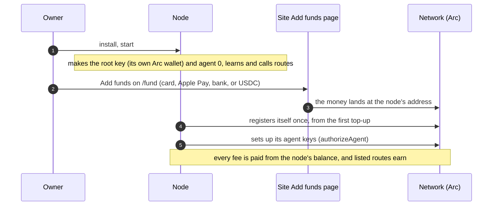

# From install to first earnings

What a new owner does, and what the node does for them, from installing it to the first fee one of their routes
earns. Written for an owner, with the code named so an engineer can follow each step. Installing is in the root
[README](../README.md#install); what each step costs is [MONEY.md](MONEY.md); the commands are [CLI.md](CLI.md).

**The node has its own wallet, and needs no account** (spec §86, which replaces §75's sign-in step). Its root key is
an ordinary Arc wallet (§1). It joins the network with that wallet; nobody signs in.

1. **On the network, with its own wallet.** Once you accept the terms on the window's first-run screen (or via `unbrowse-node terms accept`) with the peer network on (the default), the node joins with its own wallet, registers its on-chain identity once, sets up its agent keys with daily spending limits (`agents::keep_granted`), and automatically shares routes you have proven (`share_status`). Registering costs a few cents of USDC on Arc once (§3). Its first agent key is created automatically (`agents::ensure_first`), so `npm i -g unbrowse && unbrowse connect` works right away. On macOS, drag the app to Applications and open it: the **Agents** screen connects every installed local agent automatically (Claude Code, Claude Desktop, Cursor, Codex, VS Code, Gemini CLI, OpenCode, Hermes, OpenClaw, and more) and offers a remote MCP address for ChatGPT and Claude on the web ([design](design/mac-installer.md)).
2. **Local, if the owner keeps it off.** With the peer network off (`unbrowse-node network off`, or "Keep my node off
   the network" in the window), and until the terms are acknowledged, the node learns and calls its owner's routes and shares nothing
   (`health::LOCAL`). Its chain work goes on: it still claims what its agents paid, and keeps its route stakes
   ([NETWORK.md §10](NETWORK.md#10-opting-out)). Routes learned while it was off stay on it for good (`Route::local`).
3. **Linking a wallet, optional** (§2). An owner who wants earnings to cash out to a wallet of theirs, or one deposit
   to pay for several nodes, links it with email or Google, or with their own wallet. Joining never needs it.
4. **The listing's first buy, on by default.** When a listing of yours is credited, the node opens its route stake
   with 1% of the wallet's UNB at that moment and locks it for you (`coin_dev_buy`; 0 turns it off). A wallet
   with no UNB opens nothing, and the route still lists and earns. Raising the share past the default asks the
   owner in the node's own dialog (`decide.dev-buy-default-on`).

The window opens first on the terms, with the choice to keep the node off the network; the node joins only once the
owner presses Open my node (`window/src/screens/first_run.zig`). On a new node (terms never answered before) it asks
next for a sign-in, which opens the sign-in page in the browser and lets the owner through once the wallet is linked;
"Skip for now", at the foot, goes straight to the window with no wallet linked (`window/src/screens/sign_in.zig`).

- [1. Install and start](#1-install-and-start)
- [2. Linking a wallet, optional](#2-linking-a-wallet-optional)
- [3. Paying your own way](#3-paying-your-own-way)
- [4. First routes, first listing, first earnings](#4-first-routes-first-listing-first-earnings)
- [5. When you need to add funds](#5-when-you-need-to-add-funds)



---

## 1. Install and start

Install a release (`npm install -g unbrowse`, the Mac disk image, or the Linux and Windows archives: the root
[README](../README.md#install)), then open the window (`unbrowse app`) or run the node alone (`unbrowse start`, which
is `unbrowse-node`). The first start makes the **root key** and keeps it in the system's keystore, or in
`~/.unbrowse/root.key` on a machine with no desktop session ([ARCHITECTURE.md §6](ARCHITECTURE.md#6-keys-and-the-vault)).

The root key's address is **the node's wallet**: an ordinary Arc wallet (secp256k1, as any EVM wallet's key). It signs
everything the node does on the network and pays the network fees, and it holds the node's balance, its listings and
its earnings. The node joins the network with it; there is no sign-in. `unbrowse-node wallet export` writes the key
out for another wallet app.

A release runs on Arc testnet unless the repository's variable names another (`UNBROWSE_DEFAULT_CHAIN`,
`build_config.rs`, `.github/workflows/release.yml`). A plain build from source runs in **test mode**, on its own
local devnet, which pays its own fees and needs none of this page's money steps. A node that has run before stays on
its network; `unbrowse-node chain <name>` moves it.

**Seeing and copying the node's address.** The main path never needs it: Add funds sends money to the right place by
itself. When you want it anyway:

| Where | How |
|---|---|
| A shell | `unbrowse-node wallet` prints the address, your linked account, the network and what the address holds there, and how to add more when it's short. `unbrowse-node wallet address` prints the address alone, to pipe. `--copy` on either puts it on the clipboard with `pbcopy`, `wl-copy` or `xclip`, or `clip` (`main.rs` `wallet_cli`, `copy_to_clipboard`). Both read the key store, so they work with no node running, and print nothing secret |
| The window | the sidebar, shortened, with Copy address (`window/src/shell.zig`, `wallet.zig` `shortAddress`); Money's Identity panel (`wallet.zig` `identity`) |

The window reads it from the `identity` owner command, not the network, so it shows while payments aren't open.

---

## 2. Linking a wallet, optional

The node never needs this to join: it is on the network with its own wallet (§1). An owner who wants earnings to cash
out to a wallet of theirs links one, with email or Google at the site's `/link` page in their own browser, or with a
wallet of their own: the wallet signs one message naming the node (`app/src/link.rs`).

1. The node draws a nonce and opens `{site}/link/#node=<address>&nonce=<nonce>` (`link::start`, `link::page`).
   Everything is in the fragment, which never reaches a server's log. The site is the first that answers of
   `UNBROWSE_SITE` at run time, the one the build named, then `https://unbrowse.ai` and `https://unbrowse.si`
   (`link::sites`).
2. The page signs, and puts the signature in the site's relay under the nonce, held for 15 minutes, first write wins.
3. The node polls `GET {site}/relay/<nonce>` every 2 seconds for up to 15 minutes and checks the signature recovers to
   the owner it names (`link::collect`). A link signed for another key (a restored or replaced root key) doesn't load.
4. The node then shows the wallet's full address in a native dialog of its own and keeps the link in
   `~/.unbrowse/owner.json` only once the owner allows it (`link::keep_once_confirmed`). Whoever serves the page reads
   the nonce from it, so a site that isn't ours could sign with its own wallet; the owner's yes is what stops a
   payout address the owner never chose. With no screen to show the dialog, the node waits on the owner passphrase
   instead: set it once with `unbrowse-node passphrase`, then run `unbrowse-node confirm` on the machine's terminal,
   check the address it shows and type the passphrase (SECURITY.md, "The owner's yes"). Linking with your own wallet
   (`link_message`, `link_wallet`), where you name the address yourself, needs neither.

The node holds a signature, never a key: the wallet stays the owner's. `unlink` forgets the signature; linking again
links again. From the next voucher epoch a key hasn't begun, the node's keys pay from its own deposit again
(`owner_nodes::follow`). A grant the wallet made to this node's keys (`authorizeAgent`, sent from the wallet) stays on
the chain until it runs out or the wallet revokes it (`revokeAgent`, sent from the wallet): Settlement takes a revoke only
from the payer, so the node can't send it. Revoke them from the wallet if the node's keys should no longer be able to
draw on its deposit; `unbrowse-node nodes`, run before unlinking, lists them.

**What the link is for.**

- **Not the network.** The node joins with its own wallet whether or not a wallet is linked; linking changes nothing
  about what it shares (`link::on_network_since`).
- **Cash out** takes everything waiting on the chain to this node's wallet (`collect_earnings`): what locked route
  stakes earned and the route shares owed to you as a contributor. `wallet_send` sends it on to an address you name.
  A withdrawal from the deposit goes to the linked wallet when one is linked.
- **Your telemetry account.** While telemetry is on, a linked node tells the site `node_started`, `owner_linked` and
  `owner_unlinked`, each signed by the node's key and carrying the owner's link, so the site counts only events a
  node really sent, under the account that owns it (`link::tell`, `{site}/t`). The account is how Unbrowse knows you,
  in place of an API key. These events name the node's address and your account's address, never a site, route or
  input. A node with no link sends none. [PRIVACY.md](../PRIVACY.md) says the same.

**Where to link one.** The window: the sign-in a new node asks for after its terms, or later Money, Advanced, "Link a
wallet".
A shell: `unbrowse-node sign-in`. No window is needed for any of these: on a machine with no browser it prints the
page's address to open on any device, and `unbrowse-node sign-in --key-file <path>` signs with a wallet key the owner
keeps in a file of their own (`chmod 600`), here, with nothing else to open. The flow is one module the shell and any
other front end share (`unbrowse-node/app/src/login.rs`).

**From nothing to signed in, on one terminal.** `unbrowse-node onboard` walks a new owner through every step with no
window: it starts the node if none runs here (in the background, its output in `node.log` in the node's home), sets
the owner passphrase where the machine has no screen (offered where it has one), shows the terms and takes them when
`accept` is typed (`--keep-off` keeps the node off the peer network), asks how to sign in (the website, a wallet key
file, or a wallet that signs elsewhere, whose signature is pasted back), and answers the node's question for the
owner's yes on the same terminal. A step done already is skipped, so running it again carries on where it stopped.
`unbrowse-node onboard status` says where each step stands, and exits 0 only when the node runs and is signed in
(`unbrowse-node/app/src/onboard.rs`).

**Advanced: the account underneath, and bringing your own.** The account is a wallet Privy keeps for you, and the
message it signs is a plain EIP-191 one, so any wallet signs it on any chain. To use a wallet of your own instead,
`unbrowse-node sign-in --wallet <address>` prints the message and the nonce, and `--nonce … --signature …` links it
(`link_message`, `link_wallet`):

```
Unbrowse: link this node to my wallet.

Node: <node address, lowercase>
Owner: <owner wallet, lowercase>
Nonce: <32 hex characters the node drew>
```

When the node is on a live network and can't pay its own fees, it adds `&fund=<chain id>` to the link page, which
then offers one USDC transfer to the node from the owner's own wallet, once linked (§3). Withdrawing the deposit
(Advanced) also goes to the linked account (`chain::withdraw_to`).

---

## 3. Paying your own way

There is no sponsor and no free credit (spec §76). The node pays for everything from its own **balance**, one number
in dollars on the Money screen, and nobody is sent money to spend. The first top-up pays for the node's one-time
registration and its network fees too, so the screen shows one amount, "Add $X to start", until the balance can
start the node. Network fees are included in the price: they come out of the same balance.

- **Add funds** (Money) opens the site's `/fund` page, where you add money by card, Apple Pay or bank through
  Circle's Arc Onramp Kit, or send USDC yourself (`link::add_funds`, `link::fund_page`). The node notices the money by
  itself on its next pass and the screen shows it.
- **A node that only earns** needs only what starts it: its one-time registration and its entry saying where it is on
  the network.
- **A node whose agents pay others** keeps enough in its balance for them. Each agent has a **daily limit**; agents
  pay from the node's own balance by default, and paying from your account instead is an Advanced option.
- **Usage is collected automatically.** You never claim anything by hand.

The Money screen never offers to withdraw the balance: what you add is for your agents to spend. Earnings are apart
from it, and Cash out sends what is available to your linked wallet, or keeps it in the node's own (§4).

`unbrowse money` prints the same from a shell: the balance, what starts the node, each agent's daily limit and
what it spent today, earnings, and the link that adds funds (`main.rs` `money_cli`, `money.rs`).

**Not live yet.** Neither Arc network file names a deployment yet (`unbrowse-node/app/networks/arc-testnet.json`,
`arc-mainnet.json`: `"deployment": null`), so the app says "Payments aren't open on this network yet": a node still
learns and calls routes for its agents, and paid routes and earnings start once the operator deploys
([OPERATIONS.md](OPERATIONS.md)).

**Advanced: what the balance is made of.** USDC is what works underneath. The balance is the USDC at the node's
address, plus its deposit in the Settlement contract, plus your account's deposit while it pays for this node's agents
(`money.rs`). On Arc, USDC is also the network's gas, so the same USDC pays both. The node's background pass moves the
USDC its address holds into its deposit, up to `deposit_floor_usdc` (0.5), always leaving the gas it keeps (`main.rs`
`top_up`, `chain::top_up`). A deposit is one call with no approval first: the key signs USDC's EIP-3009 authorisation
for Settlement to pull it (`chain::deposit`). The registration is an ERC-8004 identity in Arc's IdentityRegistry
(`identity_usdc`, 0.05 USDC). `funding` reports each part (`fund_usdc`), and USDC on another chain arrives through
Arc's own CCTP v2 or Gateway (`other_chains`). A write the node can't pay for isn't sent: it says what to add
(`chain::needs_gas`). What each write costs is in [MONEY.md](MONEY.md).

---

## 4. First routes, first listing, first earnings

1. **Connect an agent.** `unbrowse connect` registers agent 0, which the node made on its first run, with Claude
   Code, starting the node first if it isn't running. `--client claude-desktop,cursor,codex,…` (or `all`), or the
   window's Connect, writes the other clients too. For another agent, `unbrowse-node agent new <name>` or the
   window's Money, "Add agent". Each key is set up on the network with its daily limit once the node is on it, and
   renewed by the node (`authorizeAgent`). [CLI.md](CLI.md#agent).
2. **Learn routes.** The agent says what it wants with `unbrowse_do` and a page that does it; the node learns the
   route once and calls it after that ([ARCHITECTURE.md §3](ARCHITECTURE.md#3-the-pipeline-browse-once-call-forever)).
3. **Pay for others' routes.** When another node lists a route for the page's site, the node fetches it and pays its
   fee by itself from its balance, up to `max_fetch_usdc` ($0.05)
   ([SHARING.md §3](SHARING.md#3-how-a-caller-finds-pays-for-keeps-and-runs-a-body)).
4. **Join the network.** With its own wallet, no sign-in: the node registers itself once, from its balance, publishes
   where it is, and joins ([NETWORK.md](NETWORK.md)).
5. **List.** Once the node is on the network, after it has shown you which routes it will share, in the default `used` mode a
   route is listed once your agents have used it successfully on 3 days or 5 times, at most 5 a day; the first
   listing sets the node's fee to $0.01 ([SHARING.md §4](SHARING.md#4-automatic-sharing)).
6. **Earn.** Another node's agent fetches your route and its use passes, and the usage is collected automatically.
   65% of the fee is the route's share. Before route staking opens on your entry, that share is owed to you in USDC as its
   contributor. Once staking is open (your node opens it with the listing's first buy, if the wallet holds UNB), the
   share goes to the route: locked stake held by wallets that have checked the route is paid its part in USDC, and
   the rest buys and locks stake in the route for the payer. So what you earn after that is what your locked stake earns, and you hold the
   first of it. Money shows it as **Ready to take**, and **Cash out** takes all of it to this node's wallet. Nothing
   is held back and nothing vests ([MONEY.md §3](MONEY.md#3-where-money-flows),
   [Payments, Staking & UNB](concepts/payments-and-unb.md)).

**Advanced: the same, in the contract's terms.** The line's payee claims its receipts once a claim is worth its gas,
and always just after the epoch (a day) ends; the payer's node claims what the payee left
([MONEY.md §2](MONEY.md#2-every-action-that-needs-funds)). The claim sends the route's share to `CoinFetch`.
`CoinStakes.claim(coin)` pays a staker what its coins earned, and `CoinFetch.withdraw` pays a contributor the shares
of lines that had no coin to buy; `collect_earnings` sends both.

---

## 5. When you need to add funds

| When | What to do |
|---|---|
| It signs in on a live network | Money, Add funds: card, Apple Pay, bank or USDC. The screen says how much starts the node ("Add $X to start"); that covers its registration and its network fees. On Arc testnet, test USDC is free from Circle's faucet, https://faucet.circle.com (`arc::ARC_TESTNET.faucet`), sent to the node's address (`unbrowse-node wallet address --copy`); on Arc mainnet it is real money |
| Your agents keep paying fees | Add funds again when the balance runs low. While the deposit is below `deposit_floor_usdc` (0.5), the node moves new money into it itself, once a pass, always leaving `gas_reserve_usdc` (0.25) for network fees (`main.rs` `top_up`, `chain::top_up`). Adding to the deposit by hand is under Advanced |
| You want the earnings | Money, Cash out, once they are available; they go to your linked wallet, or stay in the node's own |

In test mode nothing here applies: the local devnet pays its own fees, and test funds (Money, Advanced) are minted
for free.
